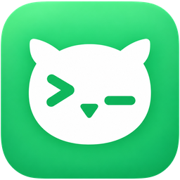
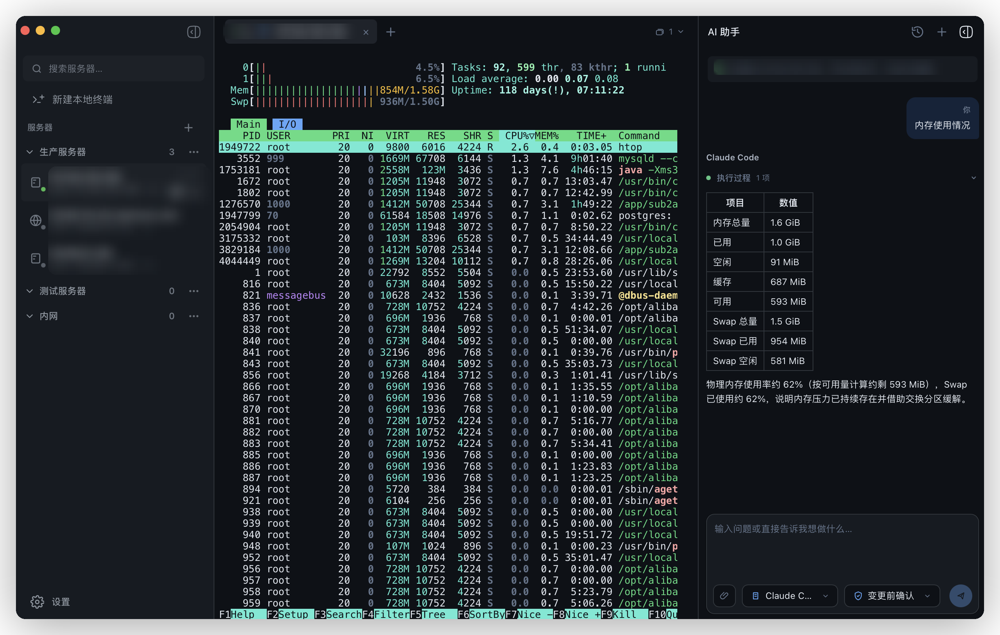
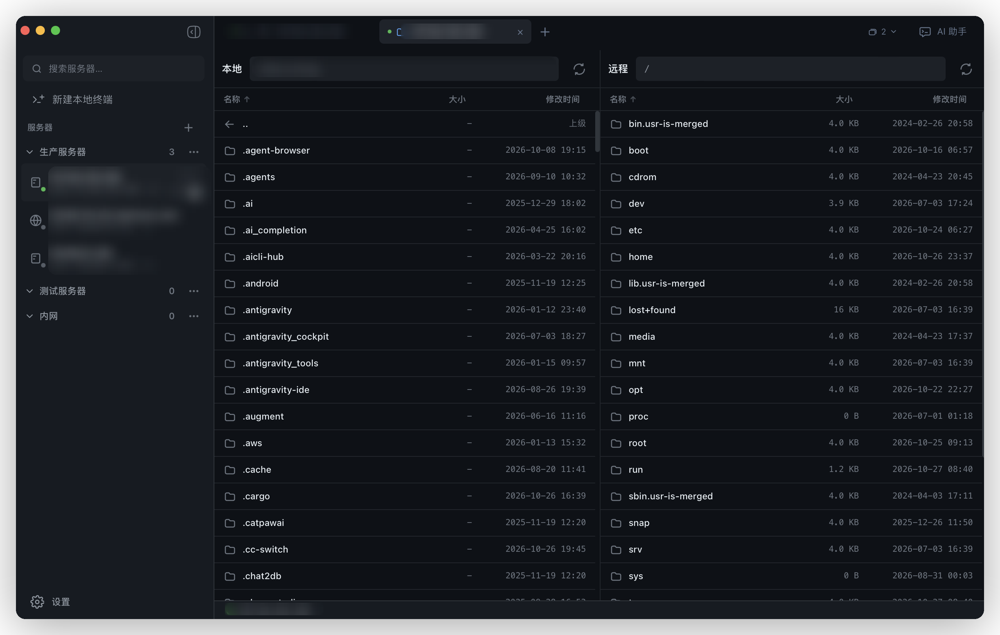
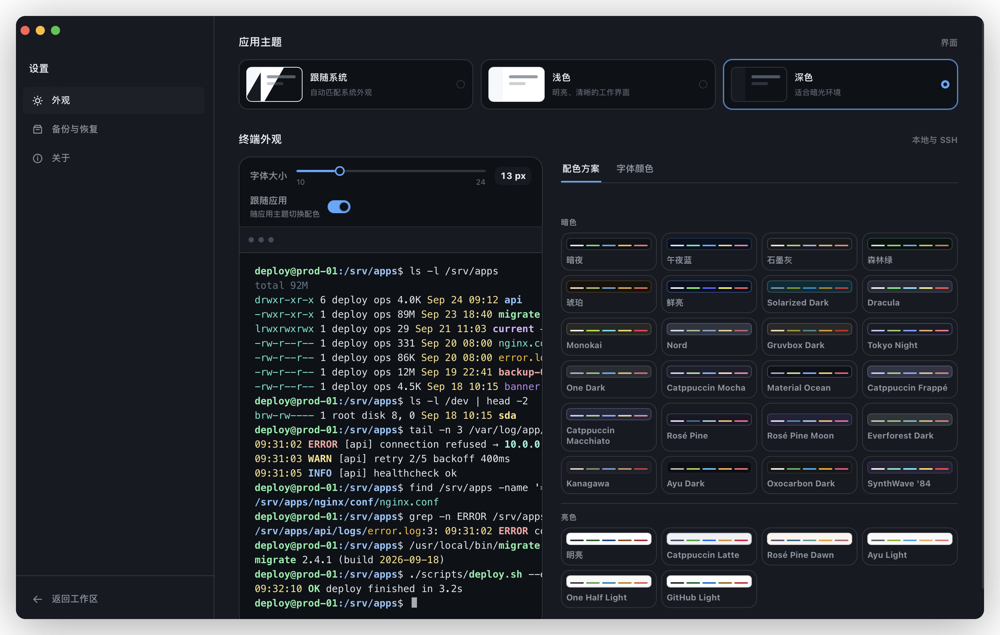

<div align="center">



# Nocterm

**本地优先的 macOS / Windows 桌面终端客户端**

统一管理本地终端、SSH、SFTP 与 AI 辅助——连接资料与凭据全部留在你的机器上。

[English](README.md) | 简体中文

[](https://github.com/slightlee/nocterm/releases)
[](https://github.com/slightlee/nocterm/actions/workflows/ci.yml)

[](LICENSE)


[下载安装](#-下载安装) · [核心特性](#-核心特性) · [界面预览](#️-界面预览) · [社区](#-社区) · [本地开发](#-本地开发) · [文档](#-文档)

</div>

---

## ✨ 核心特性

- 🖥️ **终端**：本地终端与多标签会话，跟随系统 / 浅色 / 深色主题，字体与配色可定制
- 🔗 **SSH**：连接分组、搜索与 OpenSSH Config 导入；密码 / 私钥文件 / Agent 认证，TOFU 主机密钥；进程内纯 Rust 实现，不依赖系统 `ssh`
- 📂 **SFTP**：双栏浏览、文件操作、上传下载、进度与取消
- 🤖 **AI 辅助**：接入本机 Codex / Claude Code / Grok CLI 并绑定当前终端，提供结构化服务器诊断、命令审批与脱敏审计——**AI Provider 不接触 SSH 凭据，也不能自行切换目标**，统一经 Nocterm 工具网关访问终端
- 🔒 **本地优先**：核心能力全部在本机运行，不依赖云服务；连接资料存本机 SQLite，密码进入系统凭据库（macOS Keychain / Windows Credential Manager）

## 🖼️ 界面预览

<p align="center">
  
</p>
<p align="center">
  
  
</p>

## 📦 下载安装

从 [GitHub Releases](https://github.com/slightlee/nocterm/releases) 下载最新版本：

| 平台              | 安装包                                       |
| ----------------- | -------------------------------------------- |
| Apple Silicon Mac | `Nocterm_<version>_macos_aarch64.dmg`        |
| Intel Mac         | `Nocterm_<version>_macos_x86_64.dmg`         |
| Windows x64       | `Nocterm_<version>_windows_x86_64-setup.exe` |

> [!NOTE]
> 安装前请阅读 Release Notes 确认发布通道与签名状态，并用同名 `.sha256` 文件核对安装包；预发布版本只用于其说明声明的测试范围。
> AI 面板按需使用本机已登录的 `codex` / `claude` / `grok` CLI（Grok ≥ 1.0.34），Nocterm 不代装、不代登录。

## 🚀 本地开发

环境要求：Node.js 22 · pnpm 11（Corepack 固定）· Rust 1.94 · [Tauri 2 系统依赖](https://v2.tauri.app/start/prerequisites/)。

```bash
corepack pnpm install
corepack pnpm tauri dev      # 启动桌面客户端
corepack pnpm check          # 前端质量门禁
corepack pnpm cargo:check    # Rust 质量门禁
```

## 💬 社区

- [LINUX DO](https://linux.do) — 新的理想型技术社区

## 📚 文档

安全与隐私设计、AI 工具网关边界、架构分层、测试与发布流程的完整说明：

- [技术架构](docs/technical-architecture.md)
- [开发规范](docs/development.md)
- [测试与验收](docs/testing.md)
- [发布流程](docs/release-process.md)
- [贡献指南](CONTRIBUTING.md)
- [安全策略](SECURITY.md)（安全问题请私下报告，勿创建公开 Issue）
- [Issues](https://github.com/slightlee/nocterm/issues) — 问题反馈与功能建议

## 📄 许可证

[MIT License](LICENSE) © Nocterm contributors
