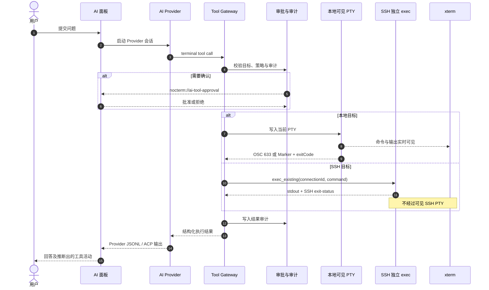
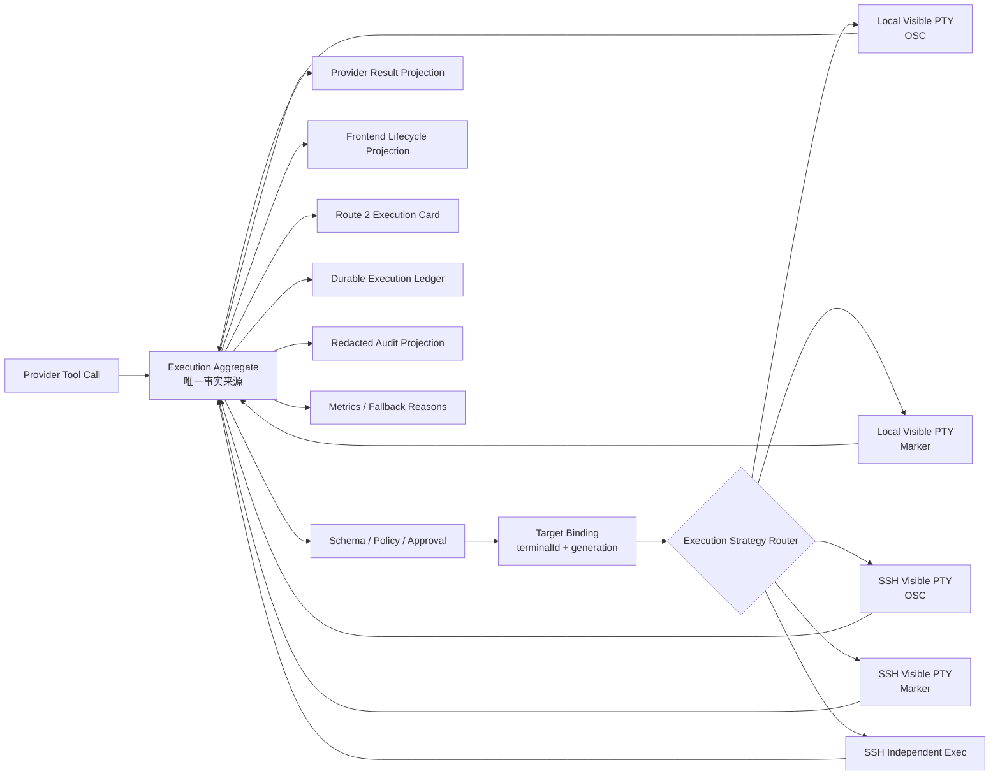
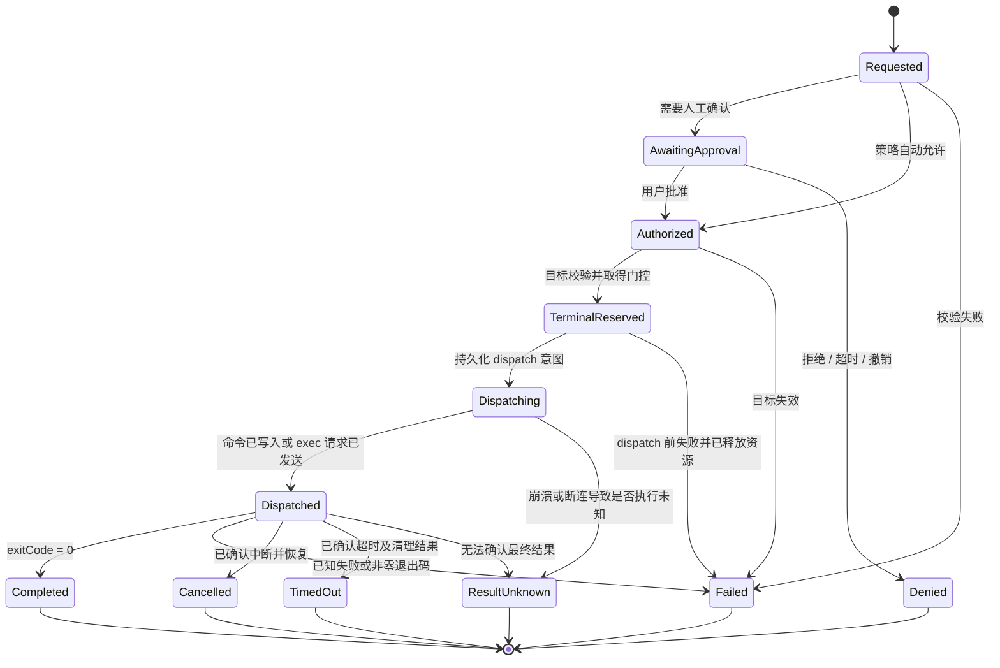
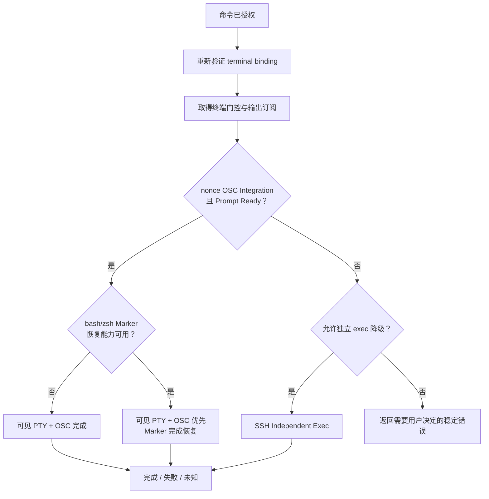

# AI 终端执行可观测与 SSH 可见执行演进方案

> 状态：架构评审草案，不代表当前已经实现的产品行为
>
> 文档版本：0.6
>
> 评审基线：`main@1dfdaf5`
>
> 首次编写：2026-10-29
>
> 最近评审更新：2026-11-02
>
> 适用范围：AI Tool Gateway、本地终端、SSH 终端、AI 面板、审批、审计与测试体系

## 0. 文档目的与使用方式

本文用于多轮架构、安全、产品和测试评审，讨论如何在保留现有可靠执行能力的前提下，逐步实现：

1. **路线 2 的轻量形态**：结构化 AI 命令执行卡和权威执行生命周期；
2. **路线 3**：本地与 SSH 终端的 shell integration、提示符就绪和可信完成检测；
3. SSH AI 命令在受支持环境中写入当前可见 PTY，命令与输出对用户实时可见；
4. nonce-bound OSC 已证明 Prompt Ready 时允许 Marker 辅助完成恢复；integration 不可用时保留独立 SSH exec channel 兜底；
5. 审批、执行、可观测、审计和失败恢复都以同一个后端执行状态机为事实来源。

本文不是实施任务清单，也不表示已经批准修改默认行为。各阶段必须单独建立 Issue、分支和 Pull Request，
遵循 `docs/development.md` 的 Issue 先行、验证记录和 Squash merge 规则。

### 0.1 与现行文档的关系

- 当前已经生效的架构以 `docs/technical-architecture.md` 为准；
- 当前测试要求以 `docs/testing.md` 为准；
- 本文经评审批准并完成对应实现后，相关稳定结论再同步回上述文档；
- 本文中的文件与行号基于评审基线，代码变化后应重新核对，不把旧行号当成运行时事实。

### 0.2 评审结论摘要

当前建议为**条件通过**，但本文尚未达到直接实施全部阶段的成熟度：

- 批准阶段 0：加固现有本地 Shell 协议和真实 Shell 测试；
- 批准阶段 1A：在 Domain/Application 建设后端权威执行聚合、ledger、请求去重和恢复；
- 批准阶段 1B：基于后端权威投影建设路线 2 轻量执行卡；
- 阶段 2 需要在 dispatch receipt、gate owner 和 SSH terminal generation 契约评审通过后实施；
- 阶段 3 只批准为具有停止条件的 SSH shell integration 技术预研；
- 阶段 4 的代码已完成精确终端绑定和安全降级，真实环境退出标准尚未完成；当前保持默认隔离，用户可按连接显式开启；
- 暂不批准完整 Warp 式 Block Terminal；
- 独立 SSH exec channel 必须长期保留为隔离执行能力和最终兜底。

可行性评级：

| 范围                  | 可行性 | 主要判断                                                      |
| --------------------- | ------ | ------------------------------------------------------------- |
| 后端执行聚合与 ledger | 高     | 跨 Domain/Application/Infrastructure 的平台级改造，但边界清晰 |
| 路线 2 轻量执行卡     | 高     | 可复用现有 AI parts 与折叠过程 UI，不需要重写 xterm           |
| SSH 精确控制面        | 中高   | 可复用本地思想，但 SSH reader、registry 和 gate 需要实质重构  |
| SSH shell integration | 中     | 技术可行，远程环境差异和启动注入具有较高不确定性              |
| SSH 可见 PTY 执行     | 中     | 依赖前述控制面和真实环境证据，工程与安全风险高                |
| 完整 Block Terminal   | 低     | 当前收益不足以覆盖终端数据模型重构成本                        |

---

## 1. 背景与问题定义

### 1.1 当前用户行为差异

当前本地和 SSH AI 命令使用两种不同的执行路径：

- 本地 AI 命令写入用户正在看的本地 PTY，命令和输出在 xterm 中实时可见；
- SSH AI 命令复用当前认证连接打开独立 exec channel，结果只返回 Provider 和 AI 面板，
  不进入当前可见 SSH PTY。

这种差异在可靠性上有明确原因，但会产生产品体验问题：

- 用户观看 SSH 终端时无法直接看到 AI 正在服务器上执行什么；
- 本地和远程终端的执行反馈不一致；
- 当前 UI 的工具活动主要从 Provider 输出推断，不是 Tool Gateway 的权威执行记录；
- Provider 输出、审批、审计和对话记录之间没有统一 `executionId`；
- 应用崩溃、网络断开或结果审计失败时，难以表达“命令可能执行但结果未知”。

### 1.2 现有 SSH exec 的价值

独立 SSH exec channel 不是缺陷或临时实现，它提供：

- SSH 协议级 `exit-status`；
- 不污染用户交互 shell；
- 不依赖提示符、终端宽度和 shell integration；
- 不继承交互 shell 临时 `cd`、环境变量、alias 和虚拟环境；
- 断开、超时和取消时可只关闭独立 channel；
- 适用于后台检查、结构化诊断和不具备可见 PTY 控制面的场景。

因此目标不是删除 exec，而是把它纳入统一策略路由，并明确告诉用户实际使用了哪种执行模式。

### 1.3 市场主流方案对照

业界没有单一适用于所有终端产品的“最优执行通道”，主流产品按自身控制边界选择不同方案：

| 路线               | 代表场景                                  | 公开能力与价值                                           | 对 Nocterm 的结论                                                     |
| ------------------ | ----------------------------------------- | -------------------------------------------------------- | --------------------------------------------------------------------- |
| Agent 自有运行环境 | Claude Code、Codex CLI、Gemini CLI 类产品 | Agent 管理子进程、输出、审批和隔离                       | 适合 Agent-native CLI，不能直接替代对现有 SSH 交互终端的控制          |
| Block Terminal     | Warp                                      | 命令与输出形成可操作 Block，Agent 在真实终端展示执行过程 | 借鉴执行卡体验，不重写当前 xterm 数据模型                             |
| Shell Integration  | VS Code、现代终端                         | OSC 633 提供 Prompt、命令边界、cwd 和退出码              | 适合作为增强控制面，但普通 SSH 自动注入可能失败，不能作为唯一远程基础 |
| 独立 SSH exec      | 传统 SSH 自动化与运维工具                 | 协议级 exit-status、状态隔离、可预测                     | 继续作为 Nocterm 默认可靠路径和最终兜底                               |
| 可见 PTY + Marker  | Netcatty 等终端 Agent                     | 命令与输出实时可见，不要求持久修改远程配置               | 可行但兼容、门控、恢复和过滤成本很高，只能渐进实现                    |

VS Code 官方 Shell Integration 文档确认 OSC 633 可表达 Prompt Start/End、Command Start、Command
Finished、退出码和带 nonce 的 interpreted command line；同时明确普通 SSH 会话中自动注入可能失败，
必要时需要手动安装。因此本文不能把 VS Code 当作“任意 SSH 环境都能自动注入”的证明。

Warp 的 Block 模型证明结构化命令记录具有产品价值，但完整 Block Terminal 需要重构终端历史、全屏应用、
光标和滚动缓冲区模型。Nocterm 当前只吸收执行状态、退出码、模式和审计关联等轻量体验。

Agent-native CLI 往往由 Agent 自己拥有执行环境，因此独立子进程和沙箱是主流选择。这个事实说明
“隔离执行”并非落后方案；Nocterm 的独立 SSH exec 应被视为长期安全底座，而不是等待删除的实现。

### 1.4 Netcatty 调研边界

Netcatty 对本地和普通 SSH 会话优先写入可见 PTY，并使用逐命令包装器、随机 Marker、提示符就绪、
合成回显和大量兼容性处理；独立 exec channel 只作为 PTY 不可用时的兜底。

该项目证明“SSH 可见 PTY 执行”可行，也表明其工程成本很高。Netcatty 使用 GPL-3.0，
Nocterm 使用 MIT，因此本文只借鉴公开机制与风险清单，不复制其源码、测试或实现细节。
Nocterm 的实现必须基于自身 Rust/Tauri 架构独立完成。

---

## 2. 目标、非目标与设计原则

### 2.1 目标

1. 每个 AI 工具调用拥有唯一、后端生成的 `executionId`；
2. 后端执行聚合对象成为审批、执行、UI、Provider 结果和审计的唯一事实来源；
3. 支持 `Authorized`、`TerminalReserved`、`Dispatching`、`Dispatched`、
   `ResultUnknown` 等安全关键状态；
4. 在存在稳定 Provider request identity 时，同一 tool call 在 dispatch 前完成幂等去重；
   跨越外部副作用边界后不承诺 exactly-once，不能确认结果时进入 `ResultUnknown`；
5. AI 面板展示结构化执行卡，不依赖 Provider 文本推断真实执行状态；
6. SSH 可见执行必须精确绑定到任务发起时的具体终端及其 generation；
7. 支持环境使用 nonce-bound OSC 633 建立 readiness，bash/zsh 可用 owner-bound Marker 辅助完成恢复；
8. 不支持或不可信环境使用现有独立 SSH exec；
9. 可见执行时命令和输出进入当前 xterm，控制协议不污染可见输出；
10. 降级、取消、超时、断连和未知结果都具有稳定、可解释的状态；
11. 审计继续保持脱敏，不保存命令、参数、输出、凭据或完整环境变量；
12. 所有新增能力具备开关、灰度指标、快速回滚和真实目标环境测试。

### 2.2 非目标

本方案不包含：

- 重写 xterm.js 或建设完整 Warp 式 Block Terminal；
- 持久化完整终端滚动缓冲区；
- 修改用户远程 `~/.bashrc`、`~/.zshrc`、fish 配置或 PowerShell Profile；
- 让 AI 绕过 Tool Gateway 直接使用 Provider 内置 Shell；
- 通过静态解析 Shell 文本来判断所有命令是否危险；
- 提供 exactly-once 的外部命令执行保证；
- 第一阶段支持全部远程 Shell、tmux、screen、ForceCommand 和网络设备 CLI；
- 把命令或完整输出写入脱敏审计表；
- 未经真实测试就把 SSH 可见执行设为默认行为。

### 2.3 设计原则

1. **安全先于一致性**：无法证明当前 PTY 可安全接收命令时，不为追求可见而强行写入；
2. **后端权威**：执行状态不由 Provider 文本或前端推断；
3. **副作用边界保守**：dispatch 前依赖稳定请求身份去重；进入外部 PTY/SSH 边界后无法保证 exactly-once，不能确认结果时进入 `ResultUnknown`，不得自动重试；
4. **显式降级**：执行卡和 Provider 结果必须公开实际模式与降级原因；
5. **精确绑定**：可见执行绑定 terminal ID 和 generation，不以 connection ID 代替终端；
6. **控制面与数据面分离**：OSC、Marker、门控和完成信号属于控制面；终端输出属于数据面；
7. **不修改持久配置**：integration 只能使用进程启动参数或受限临时资源；
8. **最小支持矩阵**：由真实测试证明支持，不因代码存在分支就声称支持；
9. **隐私默认关闭持久化**：完整命令和输出默认只存在于本轮内存与当前终端；
10. **渐进演进**：先建立执行平台，再替换 SSH 执行策略。

---

## 3. 术语与执行模式

| 术语                | 含义                                                                      |
| ------------------- | ------------------------------------------------------------------------- |
| 执行聚合对象        | Tool Gateway 中一轮命令执行的后端权威状态与元数据                         |
| 路线 2              | 本文指轻量结构化执行卡和执行记录，不指完整 Block Terminal                 |
| 路线 3              | shell integration、Prompt Ready、完成信号和可见 PTY 控制面                |
| 可见 PTY            | 用户当前 xterm 对应的本地或 SSH 交互式终端通道                            |
| 独立 exec           | SSH 已认证连接上额外打开的不带可见 PTY 的 exec channel                    |
| Prompt Ready        | 后端有正面证据表明交互 shell 正处于可以接收新命令的提示符状态             |
| terminal generation | 同一 UI 会话或 terminal ID 每次打开、重连后的单调递增世代标识             |
| nonce               | 一轮终端 integration 会话的随机关联标识，仅防串线和误匹配，不是密码学认证 |
| ResultUnknown       | 命令可能已经 dispatch，但后端无法证明其最终结果的状态                     |

计划支持的执行模式：

| 模式                   | 终端可见 | 继承可见 Shell 状态 | 完成机制                       |
| ---------------------- | -------: | ------------------: | ------------------------------ |
| `local_visible_osc`    |       是 |                  是 | nonce-bound OSC 633            |
| `local_visible_marker` |       是 |                  是 | 随机 Marker + Shell 退出码探针 |
| `ssh_visible_osc`      |       是 |                  是 | nonce-bound OSC 633            |
| `ssh_visible_marker`   |       是 |        受包装器约束 | OSC 优先 + Marker 完成恢复     |
| `ssh_independent_exec` |       否 |                  否 | SSH 协议 EOF + `exit-status`   |

Marker 包装器是否使用子 shell、是否继承 alias/function、`cd` 是否持久化必须由最终协议明确，
不能只以“可见执行”概括。执行卡必须展示真实语义。

---

## 4. 当前架构与调用链

### 4.1 当前执行流程



### 4.2 当前可复用资产

| 能力                                | 当前实现                                                                      |
| ----------------------------------- | ----------------------------------------------------------------------------- |
| AI 任务目标绑定                     | `apps/desktop/src-tauri/src/commands/ai_session.rs`                           |
| Gateway 鉴权、限流和工具目录        | `apps/desktop/src-tauri/src/commands/ai_tool_gateway.rs`                      |
| 审批与审计顺序                      | `apps/desktop/src-tauri/src/commands/ai_tool_approval.rs`                     |
| 本地统一执行生命周期                | `apps/desktop/src-tauri/src/commands/ai_terminal/local.rs`                    |
| OSC 633 跨分块扫描                  | `apps/desktop/src-tauri/src/state/osc633.rs`                                  |
| 本地 completion snapshot 与输入门控 | `apps/desktop/src-tauri/src/state/local_terminal.rs`                          |
| 本地 Marker 过滤                    | `apps/desktop/src-tauri/src/state/local_terminal.rs`                          |
| 独立 SSH exec                       | `apps/desktop/src-tauri/src/commands/ai_terminal/ssh.rs`                      |
| SSH 认证连接和 channel              | `crates/nocterm-infrastructure/src/ssh/terminal.rs`                           |
| 结构化 Provider 结果                | `apps/desktop/src-tauri/src/commands/ai_tool_contract.rs`                     |
| AI 对话 parts 持久化                | `apps/desktop/src/features/ai/model/ai-persistence.ts`                        |
| 折叠式工具过程 UI                   | `apps/desktop/src/features/ai/components/AiConversationView.tsx`              |
| 脱敏审计 Repository                 | `crates/nocterm-infrastructure/src/persistence/sqlite_ai_audit_repository.rs` |

### 4.3 当前主要缺口

1. SSH AI 目标只有 connection 级绑定，没有精确 terminal ID 和 generation；
2. SSH 输出链路没有 OSC 扫描、输出订阅、Marker 过滤和输入门控；
3. SSH open 只有 `request_pty + request_shell`，没有 integration bootstrap；
4. 前端工具活动来自 Provider 输出推断，不是 Gateway 权威事件；
5. 审计缺少 execution 关联 ID、conversation ID、终端 ID、执行模式和降级原因；
6. 审计 Repository 只有写接口，没有查询或恢复接口；
7. 对话仅在有回答文本时追加 assistant message，纯工具执行记录可能消失；
8. 当前状态模型不能准确表示 dispatch 边界和 `ResultUnknown`；
9. Unix shell integration 的钩子组合和真实 Shell 测试尚不充分。

---

## 5. 目标总体架构



### 5.1 关键架构决策

1. `ExecutionAggregate` 是运行期唯一事实来源；
2. 持久 execution ledger 保存安全状态，不保存命令和输出；
3. Provider 结果、UI 事件和审计都是聚合对象的投影；
4. Provider 原始 tool activity 只作为叙事进度，不再决定真实执行状态；
5. 每种执行策略只实现准备、dispatch、完成、取消和清理，不自行定义业务状态机；
6. Tauri 事件允许丢失，前端必须能按 conversation/session 查询后端快照恢复；
7. 审计仍然是脱敏、追加式事实记录，不承担 UI 当前状态查询职责。

---

## 6. 后端权威执行状态机

### 6.1 执行聚合对象

建议概念模型：

```text
ExecutionAggregate
├── execution_id
├── provider
├── provider_session_id
├── provider_request_id
├── conversation_id
├── tool_name
├── target
│   ├── target_kind
│   ├── workspace_session_id
│   ├── terminal_id
│   ├── terminal_generation
│   └── connection_id
├── phase
├── approval_state
├── execution_mode
├── fallback_reason
├── exit_code
├── duration_ms
├── error_code
├── sequence
├── created_at
└── updated_at
```

`provider_request_id` 用于去重同一 Provider tool call。若厂商协议没有稳定 request ID，Gateway 必须在首次接收时
生成内部调用 ID，并将其绑定到当前 Provider session 的请求上下文。

完整命令和输出不得进入该持久模型。命令只用于本轮校验、审批和执行，可在受控内存事件中提供给 UI，
但写入对话记录前必须执行明确的持久化策略。

### 6.2 状态机



### 6.3 状态语义

| 状态               | 语义                                           |             是否允许自动重试 |
| ------------------ | ---------------------------------------------- | ---------------------------: |
| `Requested`        | Gateway 已接收并校验基本调用                   |           是，尚未产生副作用 |
| `AwaitingApproval` | 等待用户决定                                   |           否，由当前审批继续 |
| `Authorized`       | 已获授权，尚未占用终端                         | 是，但必须复用同一 execution |
| `TerminalReserved` | 精确目标已校验且门控已取得                     |            是，尚未 dispatch |
| `Dispatching`      | 已持久化 dispatch 意图，正在跨越外部副作用边界 |                           否 |
| `Dispatched`       | 命令已进入 PTY 或 SSH exec                     |                           否 |
| `Completed`        | 已知成功                                       |                       不适用 |
| `Failed`           | 已知失败且最终状态明确                         |   只允许用户发起新 execution |
| `Cancelled`        | 已确认取消且执行资源恢复                       |   只允许用户发起新 execution |
| `TimedOut`         | 已确认超时及清理                               |   只允许用户发起新 execution |
| `ResultUnknown`    | 命令可能已经执行，结果无法证明                 |                 严禁自动重试 |

### 6.4 最多 dispatch 一次

外部终端副作用无法与 SQLite 事务实现 exactly-once。目标是：

- 同一 `executionId` 在正常运行期最多 dispatch 一次；
- 同一 Provider request 在同一 session 中只能绑定一个 `executionId`；
- `Dispatching` 必须在写 PTY 或发送 SSH exec 请求之前持久化；
- 应用启动时，残留的 `Dispatching` 或 `Dispatched` 统一收敛为 `ResultUnknown`；
- 存在 unresolved `ResultUnknown` 的同一目标，后续变更命令不得自动执行；
- 用户查看风险提示并显式确认后，只能创建新的 `executionId`，不能复用旧 ID 重放；
- 最终结果审计失败时必须返回“结果可能已产生，不要自动重试”的稳定错误。

### 6.5 事件顺序与恢复

所有前端事件带：

```text
executionId
sequence
phase
updatedAt
```

前端只接受 sequence 更大的事件。事件通道建立、AI 面板重新展开或窗口恢复时，前端按 conversation/session
查询后端执行快照，不能假设 Tauri 事件一定送达。

---

## 7. 精确目标绑定与并发模型

### 7.1 目标绑定

当前 SSH AI 目标按 connection 共享会话，适用于独立 exec，但不足以支持可见执行。可见执行必须固定：

```text
workspaceSessionId
    -> backend terminalId
    -> terminalGeneration
    -> connectionId
```

其中：

- `workspaceSessionId` 用于 UI 导航和会话来源；
- `terminalId` 标识具体后端 SSH PTY channel；
- `terminalGeneration` 区分断开重连后的新终端实例；
- `connectionId` 用于验证终端仍属于批准时的服务器连接。

执行前四者必须重新匹配。任何不匹配都应返回稳定目标失效错误，绝不能改用同一连接的其他终端。

### 7.2 Registry

建议把本地现有控制能力抽象为终端级 registry 契约，但不强制本地和 SSH 共用同一个具体结构：

```text
TerminalExecutionRegistry
├── resolve_binding(workspaceSessionId)
├── current_generation(terminalId)
├── subscribe_output(terminalId)
├── try_acquire_input_gate(terminalId, executionId)
├── release_input_gate(terminalId, executionId)
├── integration_state(terminalId)
├── prompt_state(terminalId)
├── completion_snapshot(terminalId)
├── begin_marker_filter(terminalId, marker)
└── clear_marker_filter(terminalId, marker)
```

Domain 只保存稳定模型和 Port；Tauri host 负责事件、DTO 与依赖装配；SSH PTY 细节仍由 Infrastructure Adapter 实现。

### 7.3 并发约束

- 同一终端同时最多一条可见 AI 命令；
- 同一 connection 的不同 terminal 可以并发；
- 独立 exec 是否允许同一 connection 并发由现有连接能力和限流决定；
- 一个 AI task 不能在可见 PTY 未恢复时切换到该终端的独立 exec 并继续执行；
- 用户输入、粘贴和 AI 输入必须经过同一个门控判定；
- resize、close 和必要的内部 Ctrl+C 不得被用户输入门控阻止；
- 门控期间用户输入不得静默丢弃或延迟重放，应在 UI 明确显示“AI 命令执行中”。

---

## 8. 执行策略路由

### 8.1 策略顺序



### 8.2 自动降级规则

只有在**命令尚未 dispatch**时允许切换策略：

- integration 或 Prompt Ready 不可用时直接降级独立 exec，Marker 不得创建 readiness；
- 已验证 OSC 控制面的 bash/zsh 可以附加 Marker 包装器，OSC 完成信号仍具有优先权；
- 已向可见 PTY 写入任何命令字节后，不得再执行独立 exec 作为重试；
- `ResultUnknown` 不得自动降级或重试；
- 降级到独立 exec 后，Provider 结果和执行卡必须标记不继承可见终端状态；
- 影响命令语义的降级应由策略决定是否要求再次确认，不能静默改变预期。

### 8.3 Provider 结果契约

现有结果已包含执行模式和是否继承可见终端状态，目标契约建议扩充为：

```json
{
  "executionId": "exec-...",
  "success": true,
  "output": "...",
  "exitCode": 0,
  "executionMode": "ssh_visible_osc",
  "visibleTerminalStateInherited": true,
  "fallbackReason": null,
  "resultState": "completed"
}
```

`resultState = result_unknown` 时不能只使用 `success: false` 概括，Provider 必须得到明确指令：

- 命令可能已执行；
- 不得自动重试；
- 应向用户说明并等待人工确认。

---

## 9. 路线 2：轻量结构化执行卡

### 9.1 定位

路线 2 不改变 xterm 数据模型，不把所有终端输出拆成 Block。它只为 AI 工具调用提供结构化记录：

- 操作目标；
- 当前阶段；
- 审批状态；
- 实际执行模式；
- 降级原因；
- 退出码；
- 耗时；
- 稳定错误；
- 跳转到任务发起终端。

### 9.2 权威事件

建议新增事件：

```text
nocterm://ai-tool-execution
```

概念 DTO：

```text
AiToolExecutionEvent
├── executionId
├── sequence
├── providerSessionId
├── conversationId
├── targetKind
├── workspaceSessionId
├── terminalId
├── terminalGeneration
├── connectionId
├── tool
├── operationLabel
├── phase
├── approvalState
├── executionMode
├── fallbackReason
├── exitCode
├── durationMs
├── errorCode
├── displayCommand?      # 仅运行期，不得默认持久化
└── updatedAt
```

事件从 Gateway 的共享审批和执行核心产生，不从各 Provider 输出解析器产生。

### 9.3 前端模型

扩展 `AiMessagePart`：

```ts
type AiMessagePart =
  | { type: 'text'; content: string }
  | { type: 'activity'; kind: 'tool'; content: string }
  | { type: 'execution'; execution: AiExecutionPresentation };
```

前端按 `executionId` 和 `sequence` 更新同一张卡。Provider 推断出的 activity 可以继续显示推理过程中的
叙事进度，但必须根据 `executionId` 去重，不得与权威执行卡重复表达同一个真实动作。

### 9.4 卡片状态

建议展示：

```text
等待确认
已授权
正在占用终端
正在执行
执行成功
执行失败
已拒绝
已取消
已超时
结果未知
```

执行模式展示：

```text
当前终端 · Shell Integration
当前终端 · Shell Integration + Marker 恢复
隔离执行 · SSH exec channel
```

独立 exec 降级提示示例：

```text
已切换到隔离执行
原因：远程 Shell 不支持 integration
不会继承当前终端的目录、环境变量或虚拟环境
```

### 9.5 持久化与隐私

第一版持久化规则：

- execution ledger 保存状态元数据，不保存命令和输出；
- 脱敏审计继续不保存命令和输出；
- 对话 `parts_json` 可以保存已完成执行卡的脱敏元数据；
- `displayCommand` 仅用于当前运行期显示，默认不写入 `parts_json`；
- 完整输出留在当前终端和 Provider 本轮结果，不复制到执行 ledger；
- 纯工具执行即使没有 assistant 文本，也必须保存完成后的 execution part；
- 将来若允许保存命令历史，必须作为独立隐私功能评审，不能顺带加入。

### 9.6 不做完整 Block Terminal 的原因

完整 Warp 式模型需要重构：

- 命令块生命周期；
- 提示符、输入和输出分段；
- 全屏应用、进度条、清屏和光标移动；
- 终端历史、搜索和滚动缓冲区；
- AI 上下文与每个 block 的关联。

当前收益不足以覆盖投入与兼容风险，因此不纳入本方案。

---

## 10. 路线 3：SSH Shell Integration 与可见执行

### 10.1 前置条件

SSH 可见执行必须同时满足：

1. AI 任务绑定到精确 terminal ID 和 generation；
2. 后端已建立该终端的输出订阅；
3. 用户输入门控可用；
4. Prompt Ready 已被正面确认；
5. integration 或 Marker 完成机制可用；
6. 取消后能证明 shell 已恢复；
7. 当前命令适合该执行语义；
8. 支持矩阵明确覆盖当前远程 shell 和环境。

缺少任何必要条件时使用独立 exec 或返回稳定错误。

### 10.2 SSH 启动状态机

```text
ChannelAllocated
    -> PtyRequested
    -> ShellProbing
    -> IntegrationBootstrapping
    -> PromptReady
    -> Interactive
```

失败分支：

```text
IntegrationBootstrapping
    -> IntegrationUnavailable(reason)
    -> NormalShellOpened
    -> InteractiveWithoutIntegration
```

不能因为 SSH channel 接受 `request_shell` 或 wrapper `exec` 就标记 Prompt Ready。必须观察首个有效的、
当前 nonce 对应的 Prompt 事件，或其他正面就绪证据。

### 10.3 启动时注入方案

目标是不修改用户持久配置。可行流程：

1. 认证完成后，通过短生命周期独立 channel 探测登录 shell；
2. 受支持 shell 使用 `request_pty + exec bootstrap` 启动交互 shell；
3. 为当前 terminal generation 生成随机 nonce；
4. 如 shell 需要临时 rc，使用随机路径、`umask 077` 和最小权限；
5. 临时 rc 先加载用户原配置，再以不覆盖用户 hook 的方式追加 Nocterm integration；
6. integration 读取后立即自删除临时文件；
7. 启动超时、权限不足、ForceCommand 或 shell 不兼容时关闭尝试 channel；
8. 重新打开普通 `request_shell`，记录 capability 和 fallback reason；
9. 断连和应用退出时清理可识别的临时资源；
10. 任何路径都不得把凭据、token、命令或完整环境写入临时脚本。

`set_env` 受 sshd `AcceptEnv` 影响，不应成为唯一传递机制。

### 10.4 nonce 的安全语义

OSC 事件建议带 terminal generation 和随机 nonce，例如概念格式：

```text
OSC 633;A;<nonce> ST
OSC 633;C;<nonce> ST
OSC 633;D;<exitCode>;<nonce> ST
```

nonce 用于：

- 防止上一条命令的迟到事件完成当前命令；
- 防止多终端或多次重连事件串线；
- 降低普通输出偶然包含合法控制序列的误匹配；
- 将 Prompt 和完成事件关联到当前 terminal generation。

nonce **不是密码学认证**。远程服务器和运行中的 shell 能看到 nonce，因此恶意服务器可以伪造事件。
若服务器本身不可信，shell 内 integration 无法建立可信控制面；安全边界仍是 SSH 连接和用户授权。

### 10.5 Prompt Ready

Prompt Ready 必须是显式状态，不使用“输出静默若干毫秒”替代。

当前唯一已实现并允许 dispatch 的正面证据是 nonce-bound OSC Prompt 事件。
Marker 只用于已取得该证据后的完成恢复，不参与 readiness 判定；其他结构化 Shell
信号必须经过独立设计与真实测试后才能加入。

以下情况不得写入可见 PTY：

- shell 启动过程正在请求输入；
- vim、less、top、REPL 或其他前台程序仍在运行；
- tmux/screen 内部状态无法确认；
- 当前 prompt 状态来自旧 generation；
- 完成信号通道仍在恢复；
- 上一条 AI 命令尚未确认恢复。

### 10.6 输入门控

执行可见命令前：

1. 原子取得终端 gate；
2. 记录占用 `executionId`；
3. 订阅输出并取得 completion snapshot；
4. 再进入 `Dispatching`；
5. 写入命令。

门控期间：

- 键盘和粘贴被拒绝，并在 UI 显示“AI 命令执行中”；
- 不缓存用户输入，避免结束后重放到错误上下文；
- resize、close 和内部 Ctrl+C 正常工作；
- 同一个 execution 的内部写入绕过用户 IPC gate；
- 正常完成后按匹配信号释放；
- 取消只表示发送了 Ctrl+C，匹配完成或恢复信号前继续持有 gate；
- gate owner 不匹配时拒绝释放，避免迟到事件解除新命令门控。

### 10.7 可见 OSC 执行

流程：

```text
验证绑定
 -> 取得 gate
 -> 订阅输出
 -> completion snapshot
 -> 确认 Prompt Ready
 -> 持久化 Dispatching
 -> 写入裸命令
 -> 标记 Dispatched
 -> xterm 实时显示
 -> 等待匹配 nonce/generation 的 OSC 633;D
 -> 排空短暂尾部输出
 -> 写入最终结果
 -> 释放 gate
```

OSC 控制序列必须在 UTF-8 解码和 xterm 事件之前剥离，但 completion 事件需要进入控制面。

### 10.8 Marker 完成恢复

Marker 只在以下前置条件全部满足时使用：

- 已识别 shell 类型；
- Prompt Ready 已由匹配 nonce 的 OSC 正面确认；
- 包装器已通过当前 shell 的真实测试；
- Marker 过滤可以跨分块、折行和 UTF-8 边界工作；
- 不处于无法判断的 tmux/screen 或受限终端环境。

包装器设计要求：

- 使用高熵随机 Marker；
- 输出一次性 END + 退出码；
- 在当前 Shell 顶层使用 `eval`，普通语法错误也能产生 END，随机 cleanup 函数只清理内部状态并恢复原退出码；
- 取消时 child 接收 Ctrl+C，wrapper 仍有机会报告恢复；
- 禁用常见分页器，防止命令等待交互；
- 明确是否使用子 shell；
- 明确 `cd`、export、alias、function 和 shell option 的语义；
- 内部包装器和 Marker 不进入 xterm 可见输出；
- 必要时发送干净的合成命令回显；
- 不依靠解析任意 Shell 文本来判断命令是否危险。

当前实现只对 bash/zsh 开启该能力：Marker 按 execution 生成 128 位随机值，
包装器回显与协议片段由跨块过滤器隐藏，终端显示合成的原命令，并保留包装器前后的
业务或异步输出。执行器观察到 Marker 后保留 250ms OSC 优先窗口；窗口内收到
nonce-bound D 时仍以 OSC 退出码完成，否则仅由相同 owner 返回结果并释放 gate，
不恢复 Prompt Ready。下一次可见执行仍须等待可信 nonce-bound A/D，否则降级
independent exec。无 echo 且 Marker/OSC 均缺失时过滤器最多缓冲 128 KiB；过滤
窗口在执行截止加中断确认余量后结束，超限或超时都转入降级直通——完成检测仍然
生效并据此释放 gate，其余输出只剔除含 Marker 的完整行，绝不无限吞输出。Marker
不能激活未 bootstrap 的终端，也不能让 unsupported shell 绕过 independent exec。

### 10.9 独立 exec 兜底

现有 `execute_ssh_sync` 保持独立策略，不并入可见 PTY 实现细节。

允许兜底的典型原因：

```text
integration_unavailable
prompt_not_ready
unsupported_shell
restricted_shell
multiplexer_unverified
marker_filter_unavailable
terminal_control_plane_unavailable
```

独立 exec 结果必须：

- `executionMode = ssh_independent_exec`；
- `visibleTerminalStateInherited = false`；
- 携带 `fallbackReason`；
- 在执行卡中明确提示不会继承可见 shell 状态；
- 继续使用协议级 exit-status；
- 取消或超时时只关闭独立 channel。

---

## 11. Shell 支持矩阵

### 11.1 第一阶段承诺范围

建议第一期只承诺：

| 远程环境                        |  Integration |       Marker |                Exec fallback |
| ------------------------------- | -----------: | -----------: | ---------------------------: |
| Linux OpenSSH + bash            | 已实现待验收 |         支持 |                     必须支持 |
| Linux/macOS OpenSSH + zsh       | 已实现待验收 |         支持 |                     必须支持 |
| fish                            | 已实现待验收 |       不启用 |                     必须支持 |
| Windows OpenSSH + PowerShell    | 已实现待验收 |       不启用 |                     必须支持 |
| cmd.exe                         |       不支持 |       不启用 |                     必须支持 |
| ForceCommand / restricted shell |       不支持 | 原则上不支持 |           必须支持或明确失败 |
| tmux / screen 内部 shell        |       不承诺 |       仅实验 |                     必须支持 |
| 网络设备 CLI                    |       不适用 |       不适用 | 使用现有结构化或专用执行路径 |

### 11.2 当前 integration 加固前置

在复用现有 Unix integration 前必须解决：

- bash 不覆盖用户已有 `PROMPT_COMMAND`；
- zsh 不直接覆盖用户已有 `precmd` / `preexec`；
- fish 使用能覆盖每条命令完成的正确事件；
- 支持重复注入和幂等清理；
- Prompt 和完成事件带 nonce/generation；
- 增加真实 bash、zsh、fish 和 PowerShell Shell 测试；
- 验证特殊 prompt、Oh My Zsh、慢启动和启动时交互。

---

## 12. 持久化、审计与隐私

### 12.1 数据分层

```text
Execution Ledger
  保存当前/最终执行状态，用于恢复与查询
  不保存命令和输出

AI Audit
  追加式脱敏安全记录
  不保存命令、参数、输出、主机账号或凭据

Conversation parts_json
  保存面向用户的脱敏执行卡
  默认不保存完整命令和输出

Runtime memory
  临时保存本轮批准和执行所需完整命令
  任务结束后释放
```

### 12.2 Execution Ledger 建议字段

```text
execution_id              primary key
provider
provider_session_id
provider_request_id
conversation_id
workspace_session_id
terminal_id
terminal_generation
connection_id
tool
phase
approval_state
execution_mode
fallback_reason
exit_code
duration_ms
error_code
sequence
created_at
updated_at
```

建议增加唯一约束：

```text
(provider_session_id, provider_request_id, tool)
```

如果 Provider request ID 不稳定，只对内部规范化 request ID 建立约束。

### 12.3 启动恢复

应用启动时：

- `Requested`、`Authorized`、`TerminalReserved` 且未 dispatch 的记录标为 interrupted/failed，
  可安全由用户重新发起；
- `Dispatching`、`Dispatched` 记录标为 `ResultUnknown`；
- 不自动重新执行；
- 前端显示待人工确认记录；
- 旧 terminal generation 的门控和订阅资源不得恢复；
- 脱敏审计追加恢复结果。

### 12.4 保留策略

执行 ledger 的保留周期需要独立评审。建议第一版与现有 AI 审计保持相近上限，但不得直接假定完全一致，
因为 UI 查询和安全审计的目的不同。最终策略需明确：

- 条数上限；
- 时间上限；
- conversation 删除时是否同步删除 execution projection；
- audit 与 ledger 的独立保留；
- 用户导出和清除行为。

---

## 13. 错误模型与用户提示

建议新增或规范稳定错误码，最终名称在实现评审中确定：

| 类别               | 示例语义                                                                                                                  |
| ------------------ | ------------------------------------------------------------------------------------------------------------------------- |
| 目标失效           | 终端已关闭、重连或 generation 不匹配                                                                                      |
| 终端忙             | 当前终端已有 AI 命令执行或仍在恢复                                                                                        |
| Prompt 未就绪      | 当前 shell 不处于可接收命令的提示符状态                                                                                   |
| Integration 未确认 | bootstrap 已注册 nonce 但从未观察到可信完成事件，远端钩子大概率未生效（区别于 Prompt 未就绪：后者曾就绪、被用户键入失效） |
| Integration 不可用 | 注入、启动或 OSC 协议不可用                                                                                               |
| Marker 不可用      | shell 未知或输出过滤不可信                                                                                                |
| 执行已 dispatch    | 命令已经进入终端，禁止自动重试                                                                                            |
| 结果未知           | 命令可能已经执行，但无法确认结果                                                                                          |
| 审计不完整         | 命令可能执行，但最终审计写入失败                                                                                          |
| 门控恢复中         | 已发送 Ctrl+C，尚未证明 shell 恢复                                                                                        |

UI 不解析 stderr 或中文文本决定行为，所有分支依赖稳定 code 和结构化 phase。

---

## 14. 可观测性与灰度

### 14.1 必要指标

不记录命令、输出、凭据或完整环境，只记录聚合指标：

- 各执行模式使用次数；
- integration 激活成功率；
- Prompt Ready 等待时间与超时率；
- Marker 完成恢复率；
- 独立 exec fallback 率及原因；
- 各模式成功、失败、取消、超时和 ResultUnknown 数量；
- gate 持有时间；
- gate 恢复失败次数；
- terminal binding mismatch 次数；
- Provider 重复 tool request 去重次数；
- 事件重放或前端快照恢复次数；
- 审计写入失败次数。

### 14.2 零容忍安全指标

以下任一事件出现都阻止扩大灰度：

- 未批准命令被 dispatch；
- 同一 `executionId` 重复 dispatch；
- 命令写入错误 terminal generation；
- 门控 owner 不匹配却被释放；
- ResultUnknown 被自动重试；
- 完整命令、输出或凭据进入脱敏审计；
- integration 修改用户持久 rc 文件。

### 14.3 功能开关

建议至少有内部能力开关：

```text
aiExecutionCards
sshVisibleAiExecution
sshShellIntegrationBootstrap
sshMarkerFallback
```

正式名称由设置体系评审确定。关闭 SSH 可见能力后必须立即回到当前独立 exec，不需要数据库回滚。

---

## 15. 分阶段实施计划

### 阶段 0：加固共享 Shell 协议

目标：证明现有本地 integration 可以成为跨本地/SSH 的协议基础。

交付：

- 修正 bash、zsh、fish hook 组合；
- 增加 nonce/generation；
- 增加真实 Shell 自动化测试；
- 验证跨分块、窄窗口、UTF-8、取消和迟到信号；
- 保持现有 Marker 回退。

退出标准：

- 支持矩阵内真实 Shell 测试通过；
- 不覆盖用户 hook；
- 伪造旧 generation 事件不能完成当前命令；
- 本地现有行为无回归。

### 阶段 1：执行平台与路线 2 执行卡

目标：不改变当前执行方式，先建立唯一事实来源。

交付：

- `executionId` 和 Provider request 幂等；
- 权威状态机；
- execution ledger；
- Backend lifecycle event 和快照查询；
- `AiMessagePart.execution`；
- 结构化执行卡；
- 当前本地 PTY 和 SSH exec 接入；
- ResultUnknown 和启动恢复；
- Provider activity 去重。

退出标准：

- 审批、自动允许、拒绝、失败、取消、超时和审计失败都有完整卡片；
- tools-only 回合重启后仍有脱敏记录；
- 前端丢事件后可从快照恢复；
- 同一 request 不重复 dispatch。

### 阶段 2：SSH 精确控制平面

目标：建设可见执行基础，但命令仍默认走独立 exec。

交付：

- SSH workspace session / terminal / generation registry；
- 输出订阅；
- OSC scanner；
- Prompt state；
- SSH input gate；
- Marker 过滤框架；
- terminal busy UI；
- 精确目标失效错误。

退出标准：

- 多 SSH Tab 不串线；
- 重连后旧 token 和旧 generation 无效；
- gate 不静默吞键；
- close、resize、退出和断连释放所有资源。

### 阶段 3：SSH Integration 技术预研

目标：仅在测试环境验证启动注入，不面向普通用户承诺。

第一期矩阵：

- Ubuntu/OpenSSH/bash；
- macOS 或 Linux/OpenSSH/zsh；
- 默认 rc 与常见自定义 rc；
- 慢启动；
- 无可写临时目录；
- ForceCommand；
- 启动时要求输入；
- 异常断开和残留清理。

退出标准：

- 不修改持久 rc；
- 临时文件最小权限并可靠清理；
- 首个 Prompt Ready 可被正面识别；
- 不支持环境正常回退；
- integration 失败不影响普通 SSH 连接。

### 阶段 4：SSH 可见执行灰度（代码完成，真实环境验收未完成）

当前目标：按连接显式 opt-in，默认关闭；真实环境退出标准通过后再评审默认值。

策略顺序：

```text
nonce-bound OSC
    -> bash/zsh owner-bound Marker completion recovery
    -> independent exec
```

退出标准：

- 所有安全不变量保持；
- fallback 原因可观测；
- 取消后 shell 恢复和 gate 释放稳定；
- 真实 macOS 和 Windows 客户端连接测试服务器通过；
- 文档和 `docs/testing.md` 同步。

### 阶段 5：扩大矩阵与默认值评审

当前产品保持隔离执行默认值；以下兼容矩阵通过后再评审可见优先：

- 持续验证 fish、PowerShell 与 Windows OpenSSH 的真实环境兼容性；
- 是否支持 tmux/screen；
- 可见优先在各受支持 Shell 上的成功率；
- 是否建设全局 operation center；
- 是否允许用户选择“可见执行优先”或“隔离执行优先”。

未通过 Prompt Ready、精确终端身份或输入门控校验时，仍必须在 dispatch 前降级独立 exec，不能为维持默认可见而放松安全不变量。

---

## 16. 测试与验收门槛

### 16.1 状态机与幂等测试

- 批准前取消；
- 批准后、占用终端前取消；
- TerminalReserved 后 dispatch 前失败；
- Dispatching 时进程崩溃；
- Dispatched 后断连；
- 命令完成但最终审计写入失败；
- Provider 重试同一个 request；
- 相同命令但不同 request；
- ResultUnknown 后 Provider 自动重试被拒绝；
- 前端重复、乱序和迟到 execution event；
- 应用启动恢复残留记录。

### 16.2 目标绑定与并发测试

- 同一连接多个 SSH Tab；
- A 发起任务后切换到 B；
- A 执行前关闭；
- A 断开重连但 workspace session 不变；
- 旧 generation 发送完成事件；
- 不同连接并发；
- 同一终端两条 AI 命令竞争 gate；
- 用户输入与 AI dispatch 同时发生；
- gate 期间粘贴、resize、close 和 Ctrl+C。

### 16.3 协议测试

- OSC 跨字节块；
- UTF-8 跨字节块；
- 输出包含普通 OSC 633 文本；
- 输出包含旧 nonce；
- Marker 跨块和折行；
- 输出包含类似 Marker 的用户文本；
- 40 列窄终端；
- 超过 128 KiB 输出；
- 命令无换行结束；
- shell 语法错误；
- Ctrl+C；
- command timeout；
- completion 先于提示符重绘；
- 迟到 completion。

### 16.4 真实环境测试

第一期至少：

- Ubuntu bash；
- macOS 或 Linux zsh；
- Oh My Zsh；
- 自定义 `PROMPT_COMMAND`；
- SSH 非标准端口；
- 密码、私钥和 Agent 认证；
- 无可写临时目录；
- ForceCommand；
- 慢启动 shell；
- shell 启动时要求用户输入；
- 网络抖动和远端主动断开；
- 应用退出时有运行中命令。

macOS 和 Windows 客户端必须分别真实运行，不能用一种客户端平台替代另一种。

### 16.5 路线 2 UI 测试

- 卡片状态与后端 phase 一致；
- execution event 丢失后快照恢复；
- Provider activity 与执行卡不重复；
- 后台任务不抢焦点；
- 跳转回精确终端；
- 终端已关闭时不新建、不重连；
- ResultUnknown 使用高风险提示；
- exec 降级明确显示不继承可见 Shell 状态；
- 重启后完整命令和输出没有被意外持久化；
- 无 assistant 文本的工具回合仍保留执行卡。

---

## 17. 发布、回滚与兼容性

### 17.1 回滚策略

- 路线 2 卡片可通过功能开关关闭，后端执行状态和审计仍保留；
- SSH integration bootstrap 可独立关闭，连接恢复普通 `request_shell`；
- SSH 可见执行可独立关闭，策略立即回到独立 exec；
- 关闭 SSH 可见执行会同时关闭 Marker 完成恢复；
- 数据库 migration 必须向前兼容旧版本读取不到新表的场景；
- 不通过删除用户数据库实现回滚；
- 已存在 `ResultUnknown` 记录不能因关闭功能而自动清除或重试。

### 17.2 协议兼容

- Provider Tool Schema 新增字段时保持旧 Provider 可忽略；
- execution event DTO 使用显式版本或可选字段；
- 未识别 execution mode 的前端显示“未知执行模式”，不得当作独立 exec；
- 旧 AI 历史没有 execution parts 时继续按现有 activity 展示；
- 新版后端与旧版前端组合不在正式支持范围时，应通过应用整体版本约束避免混用。

---

## 18. 风险登记

| 风险                               | 影响                 | 缓解措施                                       |
| ---------------------------------- | -------------------- | ---------------------------------------------- |
| Provider、UI、审计形成多个事实来源 | 状态矛盾、重复卡片   | ExecutionAggregate 唯一权威                    |
| dispatch 边界崩溃                  | 重复执行或伪失败     | Dispatching + ResultUnknown + 禁止自动重试     |
| 写入错误 SSH Tab                   | 高风险远程误操作     | terminal ID + generation + connection 四元绑定 |
| OSC 误匹配                         | 提前完成、释放 gate  | nonce/generation；明确不是安全认证             |
| Prompt 判断错误                    | 命令输入 vim/REPL    | 只接受正面 Prompt Ready；否则 exec             |
| 用户输入被吞                       | 数据丢失、误操作     | 明确 busy UI；拒绝且不缓存输入                 |
| 临时 rc 泄漏                       | 安全和合规问题       | 随机路径、0600、umask 077、自删除、断连清理    |
| 修改用户 hook                      | 破坏 Shell 配置      | 组合而非覆盖；真实 Shell 测试                  |
| Marker 污染显示                    | 用户体验差、协议泄漏 | 跨块过滤和合成回显                             |
| 独立 exec 降级改变语义             | 目录和环境不一致     | mode/fallbackReason 明示，必要时再次确认       |
| 完整命令进入持久化                 | 凭据和 Token 泄漏    | ledger/audit 不存命令；parts 默认脱敏          |
| tmux/screen 重写控制序列           | 完成信号失效         | 第一阶段不承诺；使用 exec                      |
| 扩大支持矩阵过快                   | 长尾故障             | bash/zsh 起步，数据驱动扩展                    |

---

## 19. 待评审决策

以下问题需要在对应阶段开始前形成明确 ADR 或评审结论：

1. execution ledger 是独立表，还是扩展现有审计模型；本文建议独立表；
2. `displayCommand` 是否允许写入 conversation `parts_json`；本文建议第一版不持久化；
3. Marker 模式是否统一使用子 shell，以及 `cd`/export 的语义；
4. 从可见策略降级到独立 exec 是否需要再次确认；
5. SSH integration 临时资源使用远程临时目录还是 stdin/bootstrap 方案；
6. 第一阶段远程 shell 支持矩阵；
7. tmux/screen 是明确不支持还是实验支持；
8. ResultUnknown 对同一目标的后续只读命令是否也阻塞；
9. execution ledger 的保留周期和用户清除入口；
10. 可见执行成熟后是否改变默认值；
11. 用户是否可以按连接选择“可见优先”或“隔离优先”；
12. operation center 是否纳入后续产品路线。

---

## 20. 架构不变量

任何实现和后续评审都不得破坏：

1. 未批准命令永远不会 dispatch；
2. Provider 不能绕过 Gateway 使用宿主 Shell；
3. 一个 `executionId` 最多 dispatch 一次；
4. 不能证明最终结果时使用 `ResultUnknown`；
5. ResultUnknown 不得自动重试；
6. 可见执行只能写入任务批准时绑定的 terminal generation；
7. 同一终端同时最多一条可见 AI 命令；
8. 门控期间不静默吞掉或延迟重放用户输入；
9. 取消请求不等于 shell 已恢复；
10. 降级到独立 exec 必须公开执行模式和状态继承差异；
11. 不修改用户持久 Shell 配置；
12. 不通过关闭主机密钥、权限、审批、TLS 或错误处理换取功能可用；
13. 脱敏审计不保存命令、参数、输出、凭据和完整环境；
14. 完整命令和输出不得因执行卡功能被意外持久化；
15. SSH 可见执行关闭后，现有独立 exec 仍能正常工作；
16. 功能是否支持由真实目标环境测试决定，而不是由静态代码或模拟测试决定。

---

## 21. 代码基线索引

评审时应至少重新检查：

- `apps/desktop/src/features/ai/hooks/use-ai-runtime.ts`
- `apps/desktop/src/features/ai/model/ai-output.ts`
- `apps/desktop/src/features/ai/model/ai-runtime-output.ts`
- `apps/desktop/src/features/ai/model/ai-types.ts`
- `apps/desktop/src/features/ai/components/AiConversationView.tsx`
- `apps/desktop/src-tauri/src/commands/ai_session.rs`
- `apps/desktop/src-tauri/src/commands/ai_tool_gateway.rs`
- `apps/desktop/src-tauri/src/commands/ai_tool_approval.rs`
- `apps/desktop/src-tauri/src/commands/ai_tool_contract.rs`
- `apps/desktop/src-tauri/src/commands/ai_terminal/local.rs`
- `apps/desktop/src-tauri/src/commands/ai_terminal/ssh.rs`
- `apps/desktop/src-tauri/src/commands/local_terminal.rs`
- `apps/desktop/src-tauri/src/commands/ssh_terminal.rs`
- `apps/desktop/src-tauri/src/state/local_terminal.rs`
- `apps/desktop/src-tauri/src/state/osc633.rs`
- `crates/nocterm-domain/src/ai_audit.rs`
- `crates/nocterm-domain/src/terminal.rs`
- `crates/nocterm-infrastructure/src/terminal/shell.rs`
- `crates/nocterm-infrastructure/src/terminal/integration_bash.sh`
- `crates/nocterm-infrastructure/src/terminal/integration_zsh.zsh`
- `crates/nocterm-infrastructure/src/terminal/integration_fish.fish`
- `crates/nocterm-infrastructure/src/ssh/terminal.rs`
- `crates/nocterm-infrastructure/src/persistence/sqlite_ai_audit_repository.rs`
- `crates/nocterm-infrastructure/src/persistence/sqlite_ai_conversation_repository.rs`
- `docs/technical-architecture.md`
- `docs/testing.md`

---

## 22. 评审记录

| 日期       | 版本 | 评审角色                   | 结论                           | 主要调整                                                                                       |
| ---------- | ---- | -------------------------- | ------------------------------ | ---------------------------------------------------------------------------------------------- |
| 2026-10-29 | 0.1  | 初始架构草案               | 待评审                         | 建立路线 2 + 路线 3 组合、状态机、安全不变量和分阶段方案                                       |
| 2026-10-30 | 0.3  | 阶段 0+3 实现评审（spike） | 代码已交付，真实环境验证待执行 | 交付 Stage 0 加固 + Stage 3 bootstrap spike；kill criteria 入档；Stage 4 前置条件部分就绪      |
| 2026-11-01 | 0.4  | 阶段 4 opt-in 实现评审     | 自动化验证通过，真实环境待验收 | 交付按连接开关、精确 PTY 路由、统一工具执行路径、权威 ledger 与安全降级；Marker 仍未实现       |
| 2026-11-02 | 0.6  | Marker 安全边界复审        | 自动化验证通过，真实环境待验收 | Marker 限定为 OSC readiness 后的 bash/zsh 完成恢复；禁止用 Marker 激活普通或 unsupported shell |
| 2026-11-02 | 0.7  | PowerShell SSH 扩展评审    | 自动化与本机 Shell 验证通过    | Windows OpenSSH PowerShell 使用双探针和内存注入；不创建远端临时文件，不启用 POSIX Marker       |
| 2026-11-02 | 0.5  | 默认行为复审               | 显式开启，隔离默认             | 真实 SSH 矩阵未完成前不自动启用；用户开启后仍执行全部绑定、Prompt 与 gate 校验                 |

后续每轮评审至少记录：

- 评审范围；
- 通过、条件通过或拒绝；
- 新增风险；
- 已关闭风险；
- 决策变化；
- 对支持矩阵、阶段顺序和验收门槛的影响；
- 对 `docs/technical-architecture.md` 与 `docs/testing.md` 的同步要求。

## 23. 阶段 0+3 实现记录与 Kill Criteria（2026-10-30）

### 23.1 已交付（代码与自动化测试层面）

- **Stage 0 协议加固**：bash `PROMPT_COMMAND` 组合而非覆盖；zsh 以
  `precmd_functions`/`preexec_functions` 追加而非定义覆盖；fish 完成信号改挂
  `fish_postexec`（修复 PWD 事件漏报）；三个脚本支持 `NOCTERM_OSC_NONCE`
  环境变量驱动的 `;nonce` 尾巴输出（关联标识，非密码学认证）；
- **OSC 633 nonce 解析**：`633;A;<nonce>` 与 `633;D;<code>;<nonce>` 合法，
  空字段归一化为无 nonce，三字段以上畸形序列丢弃；旧格式完全兼容；
- **SSH bootstrap**：独立无 PTY channel 先执行 POSIX 探针，未命中时执行带固定
  前缀的 PowerShell 探针；bash/zsh/fish 使用随机 `/tmp/nocterm-ssh-<hex>.rc`
  （`umask 077` 创建、内容经 stdin 免转义），在既有登录 Shell 中 source 后立即
  删除；PowerShell 在既有登录 Shell 中 Base64 解码并内存执行，不创建远端文件；
- **fail-open 回退**：探针/上传/exec 任一失败 → 关闭尝试半区 → 重开 channel
  走普通 `request_shell` → `integration_fallback_reason` 入档；
  `open()` 绝不因 bootstrap 失败而失败；
- **Prompt Ready 状态机**（SSH registry）：bootstrap 终端必须观察到匹配 nonce
  的 A/D 事件才置位；不匹配 nonce 的事件丢弃；未 bootstrap 的终端恒为
  false（用户自装 integration 不构成可见执行依据）；用户键盘写入清除就绪；
- **Capability 观测**：nonce/shell/降级原因全部入 registry，Stage 4 策略路由
  可直接消费。

### 23.2 真实环境验证（kill criteria，由维护者执行）

以下任一现象出现即停止 Stage 4 推进、保持 independent exec 默认：

1. ForceCommand / 受限 shell 服务器上出现破坏性会话（拒绝监视未兜住）；
2. Prompt Ready 误判（bootstrap 终端未见 A 事件即被判定就绪，或伪造事件
   绕过 nonce 过滤）；
3. 远端 `/tmp` 残留临时 rc（自删除失效）或权限非 0600；
4. bootstrap 使普通 SSH 连接的建连成功率或速度出现可感知退化；
5. bash/zsh（含 Oh My Zsh、自定义 PROMPT_COMMAND/precmd）下 AI 命令的
   完成信号与退出码不可靠。

### 23.3 遗留与后续

- 真实 bash/zsh/fish 服务器端到端测试未执行（需维护者环境）；
- fish 已接入与 bash/zsh 相同的 nonce-bound OSC bootstrap，但仍待真实服务器验收；
- PowerShell/Windows OpenSSH bootstrap 已实现；本机 PowerShell 7.5.4 与 Windows
  PowerShell 5.1 已验证 nonce-bound D/A 序列，真实 Windows OpenSSH 服务端待验收；
- `docs/testing.md` 已补充 SSH integration 与可见执行验收条目，真实结果仍待维护者记录；
- Stage 4 的 opt-in、OSC 可见路由、bash/zsh Marker 完成恢复和 independent exec 降级已实现；Marker readiness 不存在独立路径，不得宣传为 unsupported shell 的可见执行能力。

## 24. 阶段 4 opt-in 实现记录（2026-11-01）

### 24.1 已交付（代码与自动化测试层面）

- SSH 可见执行默认关闭，以 connection ID 为粒度由用户显式开启，切换连接不会串用状态；
- execution target 持久化 workspace session、terminal ID、terminal generation 与 connection ID，路由只向任务发起时的精确 PTY 写入；
- Prompt Ready 检查与 AI gate 预占原子完成；用户输入在同一锁内使 Prompt Ready 失效，竞态失败时回退 independent exec；
- 通用命令与系统信息、进程、端口、日志、Docker 等结构化工具统一经过 approval/execution 编排，均遵循相同可见策略；
- execution ledger 记录实际 mode、稳定 fallback reason、sequence 和生命周期；Provider 契约依据实际记录声明是否继承可见 Shell 状态；
- bootstrap 不支持、初始化失败、控制面缺失、Integration 未确认（注入后从未观察到可信完成事件，用户可尝试重连）与 Prompt 未就绪（曾就绪、被用户键入失效）使用不同稳定 fallback reason，内部 probe/upload 错误不进入 ledger；nonce 过滤丢弃与首次可信完成事件在诊断日志留痕；
- 取消和超时从 dispatching/dispatched 映射到明确终态；前端启动后通过 ledger 快照补齐监听窗口内丢失的事件；
- SSH reader 先发布普通输出再提交同一数据块中的 OSC 完成事件，可见执行完成时再次排空队列，避免尾部输出丢失。
- bash/zsh 可见命令使用 owner-bound 高熵 Marker 包装，OSC D 在 250ms 窗口内优先；Marker 跨块过滤且只能返回原 execution 的结果、释放其 gate，不能恢复 Prompt Ready，后续无可信 A/D 时下一次执行降级 independent exec；过滤器最多缓冲 128 KiB，窗口（执行截止 + 余量）过后降级直通，并保留包装器前的异步输出。包装器回显以 ` eval '` 锚点定界完整跨度（多行命令横跨多行，防止续行泄漏），合成回显中的换行归一为 CRLF（xterm 的 LF 不回车，裸 LF 会渲染成阶梯）。
- bootstrap 回显抑制最多缓冲 128 KiB，窗口 5 秒；首个可信 nonce-bound OSC 会结束抑制并在无回显时交还正常提示符。窗口内无法精确匹配 token 时保持 fail closed；超限或超时降级为只剔除可确证内部行的直通（PowerShell 固定 token 必须叠加注入语法特征，避免吞掉用户命令），避免钩子未安装时终端假死或内存无限增长。

### 24.2 当时边界

- 默认路径仍是 independent exec，可见执行不是全局默认；
- 当前可见路由仍要求可信的 nonce-bound OSC Prompt Ready；Marker 仅恢复完成信号，不能为 unsupported shell 建立 readiness；
- bash、zsh、fish、Windows OpenSSH PowerShell、自定义提示符、ForceCommand/受限
  shell 以及 macOS/Windows 客户端的真实端到端矩阵尚未执行；
- 自动化测试证明路由、gate、持久化和尾部输出契约，不等价于真实 SSH 服务器验收。

## 25. 默认行为复审（2026-11-02）

用户目标要求 AI 面板操作可以同步呈现在所连接终端，但阶段 4 的真实环境退出标准
尚未全部通过。精确绑定、Prompt Ready 和输入门控已经具备，因此当前决策为：

- SSH 连接默认关闭“终端可见”，由用户按 connection ID 显式开启；
- 应用重启后恢复隔离执行，不持久化尚未完成兼容验收的运行时偏好；
- Prompt、generation、目标绑定或 gate 任一校验不满足时，继续安全降级独立 exec；
- 真实 macOS/Windows 客户端和 Shell 矩阵通过后，再单独评审是否默认开启。
