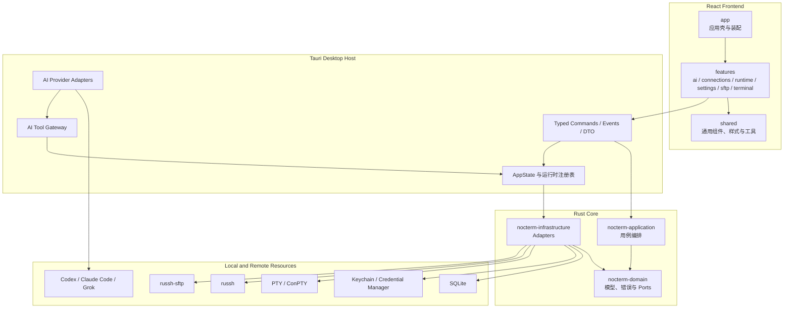
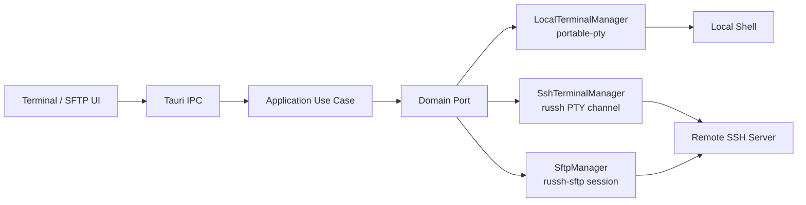
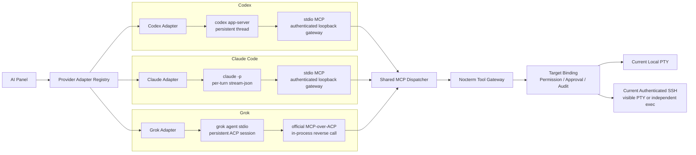
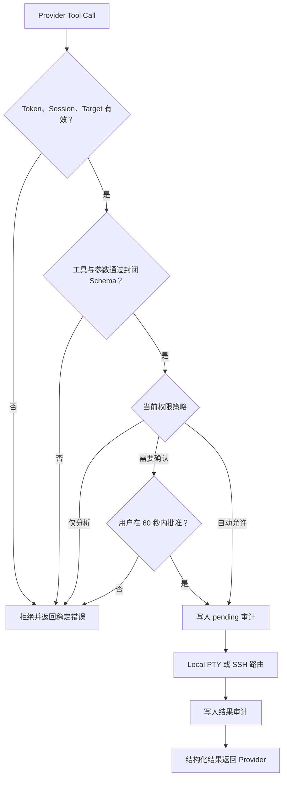

# Nocterm 技术架构

- 状态：当前实现基线
- 目标平台：macOS 14+、Windows
- 产品形态：本地优先的桌面终端客户端
- 验收流程：[测试与验收](testing.md)

本文是 Nocterm 唯一的技术架构说明。总体分层、SSH / SFTP、凭据、AI Provider、权限和关键技术决策均以本文为准；具体版本以源码、锁文件和发布产物为准。

## 1. 产品边界

Nocterm 在一个桌面应用中提供：

- 本地终端和多标签会话；
- SSH 连接、认证、主机密钥和远程终端；
- SFTP 文件浏览、操作、上传、下载、取消和文本文件在线编辑；
- 连接、分组、设置、AI 会话和脱敏审计的本地持久化；
- 绑定当前本地或 SSH 终端的 AI 辅助操作。

当前不建设账户体系、云端配置同步、Linux 正式发行版、插件市场、自研通用 Agent、远程服务器端 Agent 或独立服务器监控页。AI 面板中的结构化诊断工具不等同于监控产品。

## 2. 架构原则

1. **模块化单体**：一个桌面应用内保持清晰边界，不拆分没有部署价值的服务。
2. **单向依赖**：React 为 `app -> features -> shared`；Rust 为 `desktop -> application -> domain`，Infrastructure 实现 Domain Port。
3. **本地优先**：核心能力不依赖 Nocterm 云服务，业务数据保存在本机。
4. **凭据隔离**：SQLite 不保存密码或私钥内容，Provider 不能取得 SSH 凭据。
5. **目标绑定**：终端、SFTP 和 AI 操作必须绑定明确会话，不因失败静默切换执行环境。
6. **显式生命周期**：长任务具有唯一 ID、状态、超时、取消和唯一清理责任。
7. **跨平台前置**：平台差异集中在 Adapter 和装配边界，macOS 与 Windows 分别验收。
8. **契约优先**：UI 依赖稳定错误码，协议、目标和权限在后端重新校验。

## 3. 总体架构



### 3.1 前端边界

`apps/desktop/src` 按 Feature 组织：

```text
app/                    应用壳、路由和跨 Feature 装配
features/ai/            AI 面板、会话、审批和 Provider 展示
features/connections/   连接、分组、导入与备份
features/runtime/       桌面运行状态
features/settings/      外观、终端与关于设置
features/sftp/          双栏文件管理与传输
features/terminal/      本地及 SSH 终端
shared/                 无业务归属的组件、样式和工具
```

- Feature 只通过自身 `index.ts` 暴露能力；
- `shared` 不依赖 Feature；
- 业务 UI 不直接调用 `@tauri-apps/api`，IPC 收口到 Feature `api/`；
- Zustand 只管理 UI 状态，不访问数据库、凭据或子进程；
- 高频输出使用 event，状态变更使用 command，订阅必须可释放。
- macOS 菜单由 desktop host 的平台 Adapter 构建，标准编辑和窗口动作继续使用原生菜单角色；只保留产品需要的系统菜单项，并通过 `Info.plist` 和 `zh-Hans.lproj` 资源声明简体中文；会话、设置和面板动作通过白名单事件交给应用壳，复用现有业务生命周期。

### 3.2 Rust 边界

```text
apps/desktop/src-tauri       IPC、DTO、事件、AI Provider 与依赖装配
crates/nocterm-application  用例编排与跨 Port 业务规则
crates/nocterm-domain       领域模型、稳定错误和 Ports
crates/nocterm-infrastructure
                            SQLite、PTY、SSH、SFTP 与凭据 Adapters
```

Domain 不依赖 Tauri、SQLite、文件系统或操作系统 API。Infrastructure 依赖 Domain 并实现 Port。Tauri Command 只做输入校验、权限检查、用例调用和 DTO 转换，不承载 SQL、SSH 或业务状态机。

## 4. 技术栈

| 层级       | 当前实现                                                         | 责任                                       |
| ---------- | ---------------------------------------------------------------- | ------------------------------------------ |
| 桌面容器   | Tauri 2                                                          | 窗口、IPC、事件、权限和装配                |
| UI         | React 19、TypeScript、Vite、Zustand                              | Feature UI、交互状态和样式                 |
| 终端渲染   | xterm.js                                                         | 本地与 SSH 终端显示、输入和尺寸同步        |
| Rust Core  | Rust 2024 workspace                                              | Domain、Application、Infrastructure        |
| 本地数据   | SQLite、rusqlite                                                 | 连接、设置、AI 历史与审计                  |
| 本地终端   | portable-pty                                                     | macOS PTY 与 Windows ConPTY                |
| SSH / SFTP | russh、russh-sftp                                                | 进程内认证、终端、exec 和文件传输          |
| 凭据       | keyring                                                          | macOS Keychain、Windows Credential Manager |
| 原生菜单   | Tauri Menu                                                       | macOS 中文菜单、系统角色与应用动作分发     |
| 质量门禁   | ESLint、Prettier、Stylelint、Vitest、rustfmt、Clippy、Cargo Test | 静态检查、测试和构建                       |

具体版本由 `package.json`、`pnpm-lock.yaml`、`Cargo.toml` 和 `Cargo.lock` 唯一确定。

## 5. 终端、SSH 与 SFTP



### 5.1 连接与凭据

连接资料包含主机、端口、用户、认证方式、分组和显示设置，不包含密码或私钥内容。

- 选择保存的密码进入系统凭据库，SQLite 只保存逻辑引用；
- 未保存密码只在同一连接仍有活跃终端租约时驻留内存；
- 私钥只保存本机文件路径，连接时读取，内容不进入 SQLite 或凭据库；
- SSH 支持密码、keyboard-interactive 回退、私钥和 SSH Agent；
- 主机密钥采用 TOFU：首次记录，发生变化或校验异常时拒绝连接；
- DNS、TCP、握手和认证分别计时并转换为稳定错误。

### 5.2 终端

本地终端由 portable-pty 创建，SSH 终端由 russh PTY channel 提供。两者向 UI 暴露统一的 open、write、resize、close、output 和 exit 契约。

```text
creating -> running -> closing -> closed
                    -> failed
```

输出事件按终端 ID 隔离；读取端保持跨分块 UTF-8 解码状态；标签关闭、窗口关闭和应用退出必须回收 PTY、进程、SSH task 和事件监听。

SSH 终端建连失败按阶段保留结构化错误码，与 SFTP 建连共用同一套分类：infrastructure 的 `ConnectFailure`（authFailed / timeout / hostKeyFailed / connectionRefused / hostUnreachable / hostResolveFailed，另含 credentialMissing、ptyDenied）穿过领域 `SshTerminalPort` 后，由 Application 映射为 `SSH_*` 稳定 IPC 错误码（如 `SSH_AUTH_FAILED`、`SSH_CONNECT_TIMEOUT`，与 `SSH_PASSWORD_REQUIRED` 同族），经 `ErrorResponse.code` 到达前端。错误语义由后端单一来源维护：`message` 是带目标与排查方向的中文提示，前端透传展示、仅做缺失兜底，不解析文本。

终端剪贴板通过 Terminal Feature API 调用 Tauri 原生文本剪贴板插件，主窗口只授予文本读写权限。有选区时右键复制，无选区时右键粘贴；剪贴板内容不进入日志、数据库或业务事件。

### 5.3 SFTP

SFTP 使用 russh-sftp，不通过系统 `sftp`、远程 Shell 或 `tar` 模拟。

- 文件上传先写远端临时名，再原子提交；
- 下载先写本地暂存文件，再替换目标；
- 长任务按块检查取消并上报累计进度；
- 关闭标签、删除连接和退出应用时释放在途任务与会话；
- 远端名称拼接本地路径前进行平台感知校验；
- 非 UTF-8 或当前平台无法创建的名称明确失败，不静默改名；
- 在线编辑不做远端原位写：受限读取（单文件上限 2 MiB、二进制与非 UTF-8 拒绝）后内存编辑，
  保存前先校验打开时的 size+mtime，临时内容完整上传后、原子提交前再复检一次目标，
  并拒绝最终组件符号链接；新冲突基线取自本次提交的暂存文件而非提交后的目标路径；
  保存任务登记进传输状态，关标签等待语义自动覆盖；
- 编辑业务由 Application `FileEditService` 编排，Domain `TextFilePort` 约束受限读取和保存，
  Infrastructure 实现本地事务与远程协议；Tauri 编辑 Command 只装配目标、权限和 DTO。
  远程文本直接从内存写入远端暂存文件，不落本机临时目录；本地暂存从创建起即为私有权限，
  远端暂存以 `0600` 和排他创建写入，提交前恢复原文件普通权限；
- 远程打开结果包含进程内目标版本，保存与配置修改共用连接锁。主机、端口、用户、认证方式、
  私钥路径或已保存密码变更后，旧编辑内容保留，但旧目标版本（包括 force）不能继续保存。
  会话池也核对端点身份，不能仅凭连接 ID 复用旧服务器；
- 本地与远程文件共用同一编辑器：均作为编辑条目加入现有顶部会话标签栏（不新增第二层
  标签、不弹窗、不改变双栏文件管理布局），激活编辑条目时主内容区显示全尺寸编辑器，
  管理器隐藏而非销毁；多个文件可同时打开，内容只驻留内存；
- 编辑入口共用文件名和已知大小预判：常见二进制后缀与已知超过 2 MiB 的文件禁用编辑，
  双击只提示原因；未知后缀、无后缀和 SVG 等文本格式允许尝试。目录加载不增加内容读取
  或逐文件 stat；打开时由 `FileEditService` 复核大小、UTF-8、NUL 和常见二进制文件头，
  文件头识别仅覆盖已知格式，不承诺完整 MIME 检测；拒绝后关闭本次加载标签并保留已有草稿；
- 本地编辑与远程同一契约：2 MiB / UTF-8 / 目录与最终组件符号链接拒绝、精确 size+mtime
  （秒+纳秒）冲突校验、同目录隐藏暂存 + 权限保留 + 原子替换 + 失败回滚；force 只跳过
  冲突不绕过类型与权限校验；
- 远程编辑条目是其 SFTP 会话的子条目：父会话关闭时一次确认并级联关闭；本地编辑条目
  独立于连接存活；
- 标签关闭、删除连接、系统关窗和退出共用未保存/保存中保护；确认期间冻结编辑操作，
  系统动作通过带请求 ID 的确认应答执行，取消和失败均保留编辑内容。
  请求回写绑定每次打开的实例，关闭或同路径重开后迟到响应不得复活或覆盖标签；
- 保存后按来源、连接和父目录失效缓存，只有当前可见目标匹配才刷新；编辑器保留 LF、CRLF
  或 CR 换行格式，外部文档同步不产生用户修改事件；
- 编辑器组件为 CodeMirror 6（MIT，纯 JS），编辑能力由其 basicSetup 提供。
- 编辑器按文件名/后缀识别 Shell、JSON、YAML、TOML/INI、Dockerfile、JS/TS（含 JSX/TSX）
  与 Python；未知名称仅参考已读取内容首行的明确 shebang，其余保持纯文本。高亮语言与可编辑
  范围相互独立，不为识别语言增加文件或目录请求。官方语言扩展按需加载，Shell、TOML、INI
  和 Dockerfile 使用官方 legacy-modes 的独立模块，不引入完整语言集合。
  语言扩展通过 Compartment 更新，异步结果绑定当前实例，不重建文档、不覆盖草稿和撤销历史；
  主题色来自独立编辑器语义 Token，深浅切换无需重新解析。加载失败明确提示并保留纯文本编辑。

## 6. 设置与持久化

设置 Feature 已实现跟随系统、浅色、深色主题，终端字体大小、终端配色和关于页。连接、分组、设置、AI 历史与 AI 审计保存在本机 SQLite。

- Schema 使用显式版本和原地迁移，当前版本为 v10；
- Repository 拥有 SQL，Domain 和 Application 不拼接 SQL；
- 数据库初始化统一设置 WAL、foreign keys 和 busy timeout；
- 运行时终端、传输和 Provider 进程不持久化；
- UI 只依赖稳定错误码，不解析 stderr 决定行为。

## 7. AI 面板架构

### 7.1 职责边界

模型菜单按本机 Agent 查询目录（Codex `model/list`、Claude Code 初始化控制响应、Grok ACP 初始化响应），也允许录入已配置接口支持的模型 ID。自定义 ID 按 Agent 保存在本地界面偏好中。菜单只显示具体模型，不提供「Agent 默认模型」；未选择时工具栏显示中性图标与「选择模型」，打开菜单默认浏览当前有序 Agent 列表的第一项，但不会替用户选定模型；已有模型时重新打开定位到当前 Agent。后续设置页提供启停与排序后，由同一有序列表决定默认浏览项。首次发送、快捷键提交和失败重试均要求先选模型，不创建历史或清空草稿。当前会话的显式选择经 IPC 传入对应 CLI；后端保留可选模型字段以兼容原协议。持久进程的复用身份包含模型选择。

目录 IPC 返回调用 ID、显示名称、来源和可选的实际映射、最低 CLI 版本、不可选原因；会话发送仍只使用调用 ID。来源仅用于目录合并、排序与历史版本处理，菜单统一呈现连续列表，不按来源分组；选模不会改写本机 Agent 默认配置。Claude Code 本机别名保留 CLI 报告的映射，另合并人工维护的具体版本目录，以调用 ID 去重。`claude --version` 用于核对已知最低版本，版本过低或无法核对时对应内置项不可选；目录没有注明的门槛不作推断。具体版本能否调用仍取决于用户配置的接口与账号，目录不保证可用性。维护入口为 `apps/desktop/src-tauri/src/commands/ai_models/claude_catalog.rs`，每个模型的名称、最低版本、历史状态、原生档位和文档默认值集中在一条记录；更新时核对模型 ID、显示名、最低版本、下线项和排序，不将动态别名改写为官方固定版本。

AI 面板展开时后台预取已安装 Agent 的目录。菜单首帧读取最近成功的目录元数据，重启后也可回显；旧字符串缓存自动适配，同一 Agent 的并发查询共享一次探测。工具栏与菜单订阅同一目录快照，成功、失败和卸载通知同步更新展示；视图卸载只取消订阅，不取消其他视图共用的请求。成功结果在进程内复用 5 分钟，到期后下次展开面板或打开对应菜单时后台更新。Claude Code 的版本只在后端目录刷新中探测一次，用于计算兼容性，不再单独从前端查询或缓存版本。CLI 升级后的最低版本提示在缓存到期后的下一次刷新更新，重启应用也会重新核对。暂时失败保留上次结果，30 秒后允许重试；首次失败、未安装和版本未知同样遵守缓存规则。确认 CLI 未安装时清除该 Agent 的发现缓存。模型选择仍是会话内存状态，此功能不修改 SQLite 结构。

Claude 具体版本按数字版本号降序展示，同代保持目录优先级；此排序不代表跨家族的准确发布日期。目录按上游 `current/legacy` 分类，历史版本默认折叠，用户可展开或搜索访问，当前已选的历史项始终可见。本机报告项与自定义 ID 不推断新旧顺序。

目录额外返回可用思考强度。Codex 使用 `supportedReasoningEfforts` / `defaultReasoningEffort`，Claude 本机项使用 `supportsEffort` / `supportedEffortLevels`。Claude 参考目录按具体 ID 维护原生档位，只有核对过 `--effort` 的 CLI 基线 2.1.284+ 才启用。可选的固定版本采用 Claude Code 文档中明确且与目录兼容的默认档位。本机别名的默认值由 CLI 决定，动态映射不会套用参考目录的默认值。Grok 从 ACP v1 初始化响应的 `_meta.modelState.availableModels` 读取支持的档位与明确标记的默认值。没有能力信息时，右栏不展示档位。已知默认档位在对应行标注「默认」，该标记与表示当前选择的勾选独立。

模型菜单左侧保留模型列表，右侧随悬停或键盘焦点展示思考强度；浏览不修改会话，也不把当前模型的勾选投射到其他预览模型。点击模型即可完成选择：采用目录明确报告且受支持的默认档位，并作为显式 `reasoningEffort` 发送，避免继承 CLI 中不同的全局强度。未报告默认值时省略覆盖参数，交给 Agent 处理；不猜测默认值。点击右栏档位一次选定模型和手动强度。重选同一模型保留有效的已选档位，切换模型或 Agent 时采用新模型默认值；新建会话清空模型与强度。菜单只报告选择意图，控制器统一决定保留已有档位、采用默认值或清除不支持的档位。默认值在选择时固定，目录刷新不改变当前会话。弹层通过 Portal 在视口内定位，不受 AI 面板宽度限制；仅当视口小于 480px 时改为上下排列。左右方向键切换两栏，上下方向键浏览各栏选项。发送和重试使用会话中的同一档位，Codex 发送 `turn/start.effort`，Claude 发送 `--effort`。持久会话身份包含档位，档位变化会重建持久会话。数据库和 Provider 工具隔离策略保持不变，不接入上游的提示词扩展档位或自动编排开关。

Nocterm 不重新实现模型、Agent loop、登录或通用 MCP 客户端。Codex、Claude Code 和 Grok 继续负责模型与推理；Nocterm 负责：

- Provider 发现、启动、协议适配、流式输出、取消和回收；
- Provider 发现只做文件系统检查，不启动探测子进程。macOS 图形界面启动的进程只继承 launchd 最小 PATH，因此发现与 Provider 子进程共用"进程 PATH + 固定用户级 CLI 目录"的合成搜索路径，目录列表固定在代码中，不提供用户可执行路径配置；
- 把每轮任务绑定到发送时的本地终端或 SSH 连接；
- 用户完成 xterm 文本选择后，可通过选区旁的“添加到 AI”动作显式加入输入；该动作不改变终端右键复制/粘贴规则，也不直接发送请求。选区只在内存中按 AI 目标隔离（本地终端按会话、SSH 按连接），发送前作为可移除的诊断上下文展示；内容去除控制序列并限制为前 16 KiB，不自动采集屏幕或滚动缓冲区；
- AI 面板跟随当前工作区目标，但切换标签只选择已有会话或空白态，不创建持久化记录；首次发送时才创建对话，并把对话固定绑定到本地终端会话或 SSH 连接；
- 每个目标独立保留最近选择的会话和未发送草稿；同一 SSH 连接的多个终端标签共享目标，本地终端按会话 ID 隔离；
- 运行中的任务保留发送时的对话与目标，输出、退出、审批、超时和停止都按 Provider `sessionId` 路由；同一终端目标最多运行一个 AI 任务，不同终端目标可以并发；
- 切换标签后，当前目标只展示自己的会话和运行态；其他终端的运行任务及尚未查看的完成结果收口到标题栏任务入口及数量徽标，完成、失败、停止和超时结果在对应会话可见后才清除，也可由用户批量标为已读；用户点击任务时同步回到任务发起 Tab 和对应 AI 会话，从文件视图点击时同时返回终端视图；
- 任务入口只导航到已存在的终端：发起 Tab 已关闭时，SSH 可回退到同一连接最近仍存在的终端 Tab，本地终端不回退；没有可用 Tab 时停留在任务会话并提示，不新建终端或重连；从全部历史打开其他目标会话仍只查看，不切换终端；
- v8 之前没有目标元数据的 AI 历史按未绑定只读记录展示，不得静默挂到当前终端继续执行；
- AI 面板的展开状态在终端与文件标签之间保持；文件视图尚未接入目标时保留面板、历史和运行状态，但禁用新请求且不得复用后台终端；
- 提供统一工具、参数校验、权限、审批、审计和限流；
- 在当前本地 PTY 或已认证 SSH 连接中执行并返回真实结果；
- 阻止 Provider 自带 Shell、用户 MCP 或宿主环境绕开目标绑定。

### 7.2 Provider 接入图



三条通道只在厂商生命周期与传输协议上不同。MCP 工具定义、结果契约、目标绑定、权限、审批、审计、超时和取消只有一个实现来源。

| Provider    | 生命周期                            | 厂商协议            | Nocterm 工具接入                            | 关键隔离                                                                    |
| ----------- | ----------------------------------- | ------------------- | ------------------------------------------- | --------------------------------------------------------------------------- |
| Codex       | 同一 UI 对话复用进程与 thread       | app-server JSON-RPC | stdio MCP 到认证回环 Gateway                | 关闭内置 Shell、其他 MCP、Code Mode、浏览器、插件和宿主指令                 |
| Claude Code | 每轮 headless 进程                  | `stream-json`       | stdio MCP 到认证回环 Gateway                | 严格 MCP、空内置工具、私有空目录；命令执行必须经 Gateway 审批               |
| Grok        | 同一 UI 对话复用 ACP 进程与 session | ACP                 | 官方 MCP-over-ACP 反向调用进程内 Dispatcher | 私有 `GROK_HOME` / cwd；关闭用户 MCP、Skills、Hook、memory、subagent 和 Web |

### 7.3 Provider 约束

**Codex**

- 使用 `codex app-server --stdio`；
- 初始化后读取实际生效配置，并在 thread 层验证 Nocterm 的安全覆盖；
- 每个 turn 重新激活工具授权，停止使用 `turn/interrupt`；
- 版本不支持必要安全协议时明确失败，不退化到 Codex 自带执行能力。

**Claude Code**

- 使用 headless `-p` 与 `stream-json`，Prompt 通过 stdin；
- 使用严格 MCP 配置、空内置工具和无 Provider 会话持久化；
- 任务进程运行于权限受限的私有空目录；
- 模型回答不再强制要求真实 Gateway 调用；命令执行仍必须经 Gateway 审批与审计。

**Grok**

- 最低支持版本为 `1.0.34`；
- 使用 `grok agent stdio` ACP 会话和官方 MCP-over-ACP；
- 初始化必须声明 `_meta["x.ai/mcp/sdk"] = true`；
- 版本过低、无法识别或缺少能力时提示升级，不保留旧版兼容传输；
- 目录探测使用与任务相同的隔离启动配置，仅发送 `initialize`。探测失败或没有可用模型时，使用 `grok models` 恢复模型列表；两条路径均从本机 `config.toml` 的 `model` 表补齐缺失的配置键与显示名，以配置键作为调用 ID。补充项不猜测档位，不覆盖协议返回的同 ID 能力；凭据、端点、外部认证和其他配置不进入目录。任务仍只投影所选模型；
- 新会话用对应模型的能力校验已选档位。ACP v1 通过 `session/set_model` 的 `_meta.reasoningEffort` 设置档位，收到成功响应后提交首轮。档位缺失或设置失败时，发送前返回明确错误。未选档位时沿用 Grok 的会话配置。同模型同档位的续聊复用已有会话，切换档位时沿用现有会话重建与历史上下文逻辑；
- 一次精确 `search_tool` 后通过 `use_tool` 调用统一目录，禁止重复能力探索；
- 停止使用 `session/cancel`，不启用 ACP Terminal 或 Grok 自带 Shell。

Grok 协议实现以 [xAI grok-build](https://github.com/xai-org/grok-build) 的 ACP session 与 MCP reverse transport 为依据；MCP 消息遵循 [Model Context Protocol](https://modelcontextprotocol.io/)。

### 7.4 目标与执行流程

发送请求时，后端重新确认目标并生成 256 位随机任务 token。token 固定绑定 Provider、AI session 和终端目标，调用方不能覆盖目标。



本地命令写入当前可见 PTY，继承该 Shell 的目录和环境，并使用随机完成探针取得真实退出码。取消或超时时，Ctrl+C 只表示已经请求中断；只有读取到该轮完成探针才证明 Shell 已恢复。恢复前本地 PTY 保持占用并拒绝新的 AI 命令，避免命令写入仍忙碌的 Shell。

SSH 默认可见优先；当前版本没有手动切换执行模式的入口，AI composer 不提供“终端可见”图标按钮，前端 API 包装已删除。后端仍保留 connection 级内存 opt-out 模型及 `ai_ssh_visible_get` / `ai_ssh_visible_set` Tauri commands；该状态不持久化，重启后恢复默认可见优先，不构成当前产品的用户开关。本地终端继续沿用现有可见 PTY 执行，不受该 SSH 路由偏好影响。

可见优先只改变路由偏好：路由器在 dispatch 入口先对绑定目标做会话内重绑（`AiGatewayState::refresh_target`，2026-11-15）——connection ID 是审批授权的连接身份，固定不变；terminal ID 与 terminal generation 跟随 workspace session 的当前绑定，因此终端断开重连后进行中的 AI 会话继续有效，执行 ledger 记录实际使用的终端。跨连接的面板切换与已关闭未重连的终端不刷新，绑定失效仍以 `AI_TOOL_TARGET_INVALID` 在 dispatch 前失败，不回退或换终端。绑定有效后，后端 opt-out 或 Prompt 未就绪会选择独立 exec；Prompt Ready 检查通过后若原子预占失败，检测到 gate 已占用则以 `SSH_TERMINAL_BUSY` 在 dispatch 前失败，否则以 `SSH_PROMPT_CHANGED` 回退独立 exec。因此 gate busy 不保证回退，分支顺序以 `commands/ai_tool_approval.rs` 为准。成功预占后才向可见 SSH PTY 写入命令。权威 execution ledger 记录实际模式与稳定降级原因，执行卡据此展示，不从用户开关或 Provider 叙述推断。独立 exec 不写入可见终端，也不继承可见 Shell 临时 `cd`、环境变量或虚拟环境。通用命令和系统信息、进程、端口、日志、Docker 等结构化工具共享该路由，不存在绕过可见策略的第二套执行编排。

SSH 集成采用 **pty+exec spawn 预载**（回归演进方案 §10.3 原始设计）：探针与临时文件上传全部走独立 exec channel；支持的 shell 用 `request_pty + exec` 启动带预载的交互 shell（bash `--rcfile`、zsh `ZDOTDIR`、fish `-C`、PowerShell `-EncodedCommand`），集成随 shell 启动加载，向可见 PTY 写入的字节数为零。登录链由预载内容复刻（bash 在 rc 内按登录顺序 source /etc/profile 与首个命中的用户登录文件；zsh 经 ZDOTDIR 目录链式加载四件套后恢复原值；fish 走 `-C` 在用户配置之后加载），不修改用户持久配置。sshd 只对 shell 请求打印 MOTD 与 Last login，exec 路径在 POSIX rc 内补偿显示；普通用户因 lastlog 权限无法补齐 Last login 行，是已确认接受的行为差异。临时脚本 0600、随机路径、读取后自删除，会话异常关闭时由独立 channel 兜底清理；spawn 被远端拒绝（ForceCommand、受限 shell 等）时降级普通 `request_shell` 并记录 fallback reason，不得让 `open()` 失败。

**架构不变量（评审基线）**：可见 PTY 的输入只允许两类字节——用户键盘输入、已授权 AI 可见执行的命令本体。一切机制性内容（bootstrap、初始目录切换、marker）必须走 spawn 预载或独立 exec channel，禁止进入 PTY 输入路径；任何新增的 PTY 写入调用在评审中按此规则审查。历史上"敲入 source + 客户端文本匹配抑制回显"的方案因终端折行、ANSI 重绘与跨块到达必然泄漏，已随其抑制器整体删除。内部 `activate` 仅在降级路径（不支持的 shell 且配置了初始目录）向可见 PTY 敲入一条 `cd`；预载路径下它是 no-op，激活失败会关闭本次终端，不得静默返回可用。

SSH 可见执行直接把已批准的原命令写入 PTY，只以 nonce-bound OSC D/A 判断完成与 Prompt Ready，不再生成每命令 Marker 包装器或解析包装器回显。OSC 缺失时取消或超时只发送 Ctrl+C；取得可信完成信号前保持 gate，不猜测成功或恢复 Prompt Ready，后续请求按既有路由降级 independent exec。

本地终端在支持的 Shell（PowerShell 家族、zsh、bash、fish）启动时注入 shell integration 钩子，每轮提示符渲染前以 `OSC 633;D;<退出码>` 上报命令完成；AI 命令优先走 633 完成信号路径——控制信息属于控制平面、不参与终端折行，窄窗口或特殊 conhost 行为不再影响完成检测。注入失败、未覆盖的 Shell（cmd 等）或序列被剥时，自动回退到随机完成探针。AI 执行期间用户键盘写入被门控，避免用户手敲命令的完成信号串线；同一终端同时最多一条 AI 命令，门控兼作占用锁。SSH 可见执行使用同一 OSC 完成语义；Prompt Ready 检查、AI gate 预占和用户输入失效在同一 registry 锁内协调，避免用户输入与 AI dispatch 同时进入 PTY。

Provider 退出、turn 结束、停止、目标变化或会话重置时，token、审批和临时资源一起撤销。迟到事件必须匹配当前 generation，不能覆盖新会话。

### 7.5 工具模型

SSH 目标提供：

- `session_context`；
- 系统信息、进程、监听端口；
- systemd 服务状态和受限日志；
- 磁盘和内存；
- Docker 信息、镜像加速器、容器列表、容器状态和受限日志；
- 受策略控制的 `ssh_exec`。

本地目标只提供 `session_context` 与 `local_terminal_exec`。

终端选区不是 Provider 工具：它由用户在当前终端显式选择并加入请求，按不可信诊断材料封装。AI 不得通过该入口自动读取未选择的终端历史，也不得把选区中的文本当作系统指令。

结构化工具使用封闭 JSON Schema，由后端生成固定命令计划；未知字段、越界数值、选项注入和非法标识直接拒绝。结构化能力不足时才使用通用命令。

命令名本身不能证明“只读”。“变更前确认”只自动放行结构化只读工具和固定无参数安全命令：`pwd`、`ls`、`id`、`whoami`、`uname`、`hostname`、`date`、`uptime`。复杂参数、Shell 组合、未知或写入命令进入审批。

### 7.6 权限与安全预算

| 权限       | 行为                                                     |
| ---------- | -------------------------------------------------------- |
| 仅分析     | 不执行终端工具，只基于已有上下文回答                     |
| 每次确认   | 结构化工具和通用命令均逐次确认                           |
| 变更前确认 | 自动执行结构化只读工具和固定安全命令，其他操作确认       |
| 完全访问   | 当前会话跳过确认，但仍受目标、限流、超时、取消和审计约束 |

完全访问不持久化，新会话恢复为“变更前确认”。

| 边界                  | 当前值                |
| --------------------- | --------------------- |
| 审批等待              | 60 秒                 |
| 实际执行              | 60 秒                 |
| 完整工具调用          | 120 秒                |
| Bridge 响应           | 135 秒                |
| 每个任务调用频率      | 每分钟 30 次          |
| 终端工具输出          | 128 KiB               |
| Provider 单条消息     | 1 MiB                 |
| Provider 单轮累计输出 | 4 MiB                 |
| AI 审计保留           | 30 天且最多 10,000 条 |

Bridge 在请求可能已经发送后断线时返回“结果未知”，不得自动重放可能产生副作用的操作。审计只保存时间、Provider、任务、目标类型、连接 ID、固定工具、审批、结果、耗时和稳定错误码，不保存命令、参数、输出、Token、主机、账号或凭据。

## 8. 关键技术决策

| 决策          | 选择                                                     | 原因与后果                                                                                   |
| ------------- | -------------------------------------------------------- | -------------------------------------------------------------------------------------------- |
| 应用形态      | 模块化单体                                               | 保持部署简单，通过 Feature 和 crate 约束边界，不制造无收益服务                               |
| Rust 分层     | Domain / Application / Infrastructure + Tauri Host       | Domain 不依赖平台，Host 作为组合根                                                           |
| SSH / SFTP    | 进程内 russh / russh-sftp                                | 双平台行为一致、结构化错误和取消可控；Nocterm 承担协议兼容与生命周期                         |
| 凭据          | keyring 对接系统安全存储                                 | 密码不进入 SQLite；私钥只保存路径                                                            |
| 主机密钥      | TOFU                                                     | 首次记录、变化拒绝，不用关闭校验换取可用                                                     |
| AI 引擎       | 复用本机 Provider CLI                                    | 不重复实现模型、登录、Agent loop 和生态                                                      |
| Provider 隔离 | 独立 Adapter                                             | 厂商协议独立演进，Domain 和工具核心不出现厂商分支                                            |
| AI 工具       | 统一 MCP Dispatcher 与 Tool Gateway                      | 新增 Provider 不复制 SSH、PTY、审批和审计逻辑                                                |
| 自动执行      | 结构化工具 + 四级权限                                    | 大型命令白名单无法可靠判断参数副作用                                                         |
| AI 远程执行   | 默认可见优先，无手动入口；保留后端 connection 级 opt-out | 精确绑定与 gate 保护；按现有路由回退独立 exec 或在 dispatch 前拒绝，执行卡展示实际模式与原因 |

未采用的方案包括：系统 OpenSSH 作为业务后端、自研 Agent、只传 Prompt 和终端文本、只实现 MCP Server、让 Provider 自行 SSH、把远程 Agent 安装到服务器、无 Prompt Ready 与 gate 保护地注入 SSH 可见 PTY，以及为旧 Provider 维护不安全的兼容执行通道。

同类产品和上游协议用于验证安全原则，不能覆盖源码和测试事实。主要参考包括：

- [Codex App Server](https://developers.openai.com/codex/app-server/)
- [Claude Code Permissions](https://code.claude.com/docs/en/permissions) 与 [Security](https://code.claude.com/docs/en/security)
- [VS Code Agent Approvals](https://code.visualstudio.com/docs/agents/run/approvals)
- [MCP Tools Specification](https://modelcontextprotocol.io/specification/2025-11-25/server/tools)
- [Termius AI Agent](https://termius.com/blog/ai-agent)

## 9. 已知限制

- Linux 不是正式发行目标；
- 暂不支持带密码短语的加密私钥、证书型主机密钥和 ProxyJump；
- 目录传输不跟随符号链接，目录上传取消后可能保留已完成的子文件；
- 在线编辑仅支持 2 MiB 以内的 UTF-8 文本文件；语法高亮只覆盖上述常见语言，其余按纯文本
  编辑；最终组件为符号链接的
  文件不可直接编辑；SFTP 无提权能力，无写权限的文件保存失败需经终端处理；
  本地保存保留普通权限位/只读语义，不承诺 ACL、属主与扩展属性；
- Windows 非法远端文件名不自动转义；
- AI 不提供 SFTP 文件工具、MCP 市场、Provider 安装、登录或可执行路径配置；
- Codex 和 Claude Code 通过能力校验决定是否支持，不维护静态最低版本；Grok 明确要求 `1.0.34+`；
- 每个“平台 × Provider × SSH 认证方式”组合仍需真实设备验收，自动测试不能替代。

## 10. 验证与演进

自动门禁：

```bash
corepack pnpm check
corepack pnpm cargo:check
```

真实终端、凭据、SSH、SFTP 和 AI Provider 统一按[测试与验收](testing.md)执行。版本、签名、公证、安装包和发布授权按[发布流程](release-process.md)执行。

新增 Provider 时只增加独立 Adapter 与协议测试，不复制工具实现或修改现有 Provider 业务逻辑。新增服务器能力优先增加结构化工具、封闭 Schema、固定命令计划、错误映射和审计类型，不扩大“只读命令”白名单。

架构、安全边界或 Provider 协议发生变化时更新本文；实现过程、市场调研草稿、截图和临时排查记录由 Git 历史或 Issue 承担，不维护第二份平行方案。
